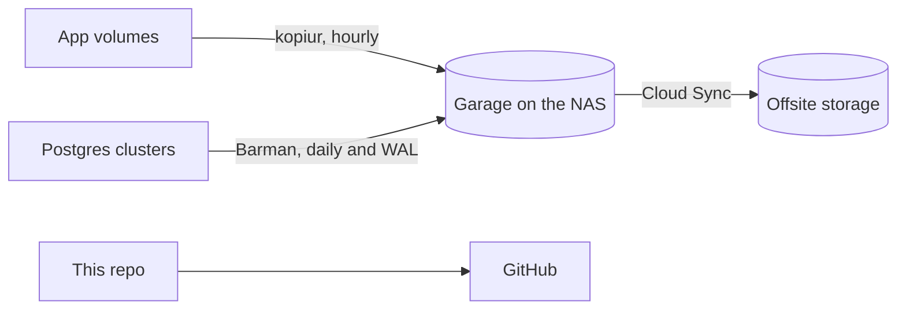

# Backups

Everything the main cluster backs up goes to [Garage](../docker/truenas/README.md#garage), the S3 store on the NAS, and the NAS copies Garage offsite. Nothing is backed up from the edge cluster by these tools.

## What is kept

| What                        | Tool                                                       | Where                                   | How often                             | Kept                                   |
| --------------------------- | ---------------------------------------------------------- | --------------------------------------- | ------------------------------------- | -------------------------------------- |
| App volumes                 | kopiur, a Kopia repository (`components/kopiur/backup`)    | Bucket `kopiur`, encrypted, zstd        | Hourly by default (`KOPIUR_SCHEDULE`) | Latest 3, 24 hourly, 7 daily, 4 weekly |
| Postgres                    | CloudNativePG with plugin-barman-cloud (`components/cnpg`) | Bucket `postgresql`, one prefix per app | A base backup daily, WAL continuously | 30 days (`CNPG_RETENTION_POLICY`)      |
| Garage itself               | TrueNAS Cloud Sync                                         | Offsite storage (not checked)           | Not checked                           | Not checked                            |
| Manifests and configuration | Git                                                        | GitHub                                  | On every merge                        | For good                               |

Secrets are not in these backups: they live in Bitwarden Secrets Manager and Proton Pass, and the SOPS age key is kept locally ([secrets](../kubernetes/apps/main/external-secrets/external-secrets/app/README.md#bootstrap-and-local-secret-tools)).

## How it comes back

- An app volume: nothing to do. The Component creates the PVC from a kopiur `Restore`, so when Flux recreates an app its volume is filled from the latest snapshot. With no snapshot it starts empty (`onMissingSnapshot: Continue`), which is what a new app needs.
- A Postgres cluster on `cnpg/restore`: nothing to do, it recovers from the latest backup when recreated. A cluster on `cnpg/initdb` comes back empty (HOMEL-63). To go back to a moment in time: [recover a CNPG database](../kubernetes/components/cnpg/RECOVERY.md).
- Garage: [restore with contents, or a fresh node](../docker/truenas/README.md#restore-with-contents). On a fresh node the buckets are empty, so the two rows above are lost with it: the offsite copy is what protects them.

## What is not covered today

- The bulk data on the NAS's `tank` pool (media, personal files), and the details of the offsite copy: this repo does not describe them (HOMEL-93).
- The edge cluster's volumes are not backed up.
- A failed snapshot or a failed database backup raises no alert; the one alert, `KopiurControllerScaledToZero`, covers the controller being stopped (HOMEL-92).
- No restore has been tested with these tools (HOMEL-94).
