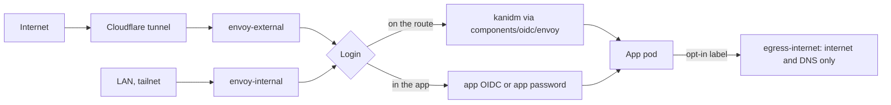

# Security

What stands between the internet, the LAN and each app, and what a new app should use. What is still open is on the board under HOMEL-31; this page says what is true today.

## The layers

| Layer               | What does it                                                                                                                                                                                                                                                    | The pattern for a new app                                                                                                                                  |
| ------------------- | --------------------------------------------------------------------------------------------------------------------------------------------------------------------------------------------------------------------------------------------------------------- | ---------------------------------------------------------------------------------------------------------------------------------------------------------- |
| Route               | Envoy Gateway: `envoy-external` (through the Cloudflare tunnel) or `envoy-internal` (LAN, tailnet). TLS 1.2 or later on both, one `ClientTrafficPolicy` in `network/envoy-gateway`                                                                              | Internal unless it must be reached from outside                                                                                                            |
| Login on the route  | kanidm, through the `components/oidc/envoy` Component: a `SecurityPolicy` in front of the `HTTPRoute`                                                                                                                                                           | For an app with no login of its own, or whose own login cannot be trusted                                                                                  |
| Login in the app    | `components/oidc` gives the app a kanidm OIDC client; the app turns its password login off where it can                                                                                                                                                         | For an app that speaks OIDC. Machine paths (APIs, readers, webhooks) keep their own keys                                                                   |
| Network             | Cilium, no default deny. `egress-internet` (`kube-system/cilium/netpols`) is opt-in: a pod labelled `policy.home.arpa/egress: internet` reaches the internet and cluster DNS only, plus what a `CiliumNetworkPolicy` beside it allows                           | Label every internet-facing app once its in-cluster calls are known                                                                                        |
| Who may reach a pod | A `NetworkPolicy` beside the app admits only its gateway (code-server, orbit) or its scope (the AI setup)                                                                                                                                                       | Ingress locks are plain `NetworkPolicy`; egress rules are `CiliumNetworkPolicy`. Each app copies its lock by hand today (HOMEL-149)                        |
| LAN-facing services | Cilium runs DSR, so a LAN client arrives as `world`: a `CiliumNetworkPolicy` with `ingressDeny` from `world` keeps a `LoadBalancer` off the LAN (Prometheus, VictoriaLogs)                                                                                      | No `LoadBalancer` without a login or such a rule                                                                                                           |
| Workloads           | No namespace enforces a Pod Security level yet (HOMEL-37). Hardened containers set non-root, no privilege escalation and drop ALL                                                                                                                               | That block on every container the image allows                                                                                                             |
| Cluster rights      | Roles defined here: read-only for the tool gateway's kubectl, Flux reconcile for its Flux tool (guarded by `ValidatingAdmissionPolicy`), batch jobs for the Miroir worker, exec on one pod for the private workshop. headlamp holds `cluster-admin` (HOMEL-146) | A `Role` in the app's namespace, never a `ClusterRoleBinding` to `cluster-admin`                                                                           |
| Secrets             | One `ClusterSecretStore`, `bitwarden-secrets-manager`, used by every namespace: any `ExternalSecret` can read any item (HOMEL-40)                                                                                                                               | An `ExternalSecret` with `dataFrom.extract` of the app's own item                                                                                          |
| Tool gateways       | ToolHive, one gateway per scope; who reaches each, and what each lists: [Models, tools and memory](../kubernetes/apps/main/llm/README.md)                                                                                                                       | A new tool server is listed on the general gateway only when it holds no private data. The private gateways list every server by default today (HOMEL-148) |

## Not covered by these layers

- Routes with neither a login on the route nor an app login checked one by one: the list is in HOMEL-39 and HOMEL-147.
- Edge has no network policies.
- Neither cluster runs a Talos host firewall.
