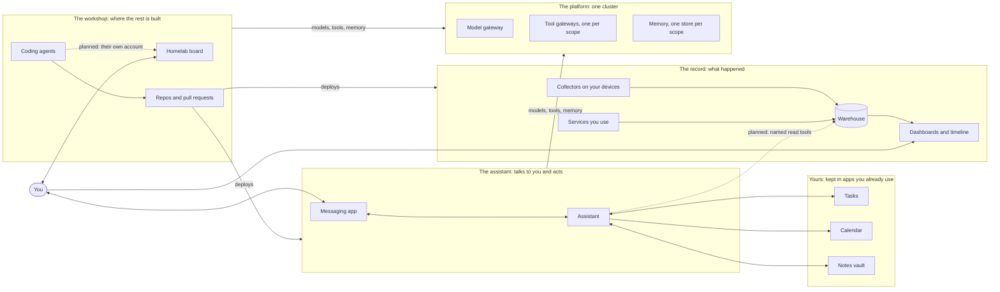

# The system: map and plan

Start here. One page for everyone who works on this: you, the assistant, and
every agent in a workshop. It says what the system is for, what its parts are,
what is being worked on, and where each part is documented. It links to the
other pages and copies nothing from them.

If you change a part, change its row here in the same pull request.

## Picking up the work

For an agent that starts with no context, and for you after a week away.

1. **Read this page**, then the page of the part you will touch (the table
   below). Each repo's `AGENTS.md` says how to build and check there. The
   code is in three repos, checked out side by side in a workshop: `home-ops`
   (this one: what is deployed), `pipelines` (Miroir and the collector) and
   `dotfiles` (what runs on your own machines).
2. **Read the board**: the Homelab list in the task app. "Doing" is what is in
   progress, at most three cards. A card is an outcome with its "done when";
   its steps say who does each. Pull requests named on a card hold the detail.
3. **Work in a branch and a pull request**, never on `main`. Someone other than
   the author reviews anything that changes behaviour.
4. **Do not read private data.** Which agent may see what is
   [the first rule of the design](../kubernetes/apps/main/llm/DESIGN.md#the-rule).
   Checks on the warehouse are counts and shapes, never contents.
5. **Finish by updating the record**: tick your step, assign the next one if it
   is his, move the card, and change the part's page and its row here. A new
   idea becomes a card in "Later", not more work now.

What is not on the board or in a page is not known to the next agent. If you
learned it and it will matter again, write it where the part is documented.

Not there yet: agents cannot read the board on their own. Until their account
exists, the "Now" list below is the copy to trust, and whoever changes the
board changes it too.

## What it is for

A second brain: something that knows what is going on, so you can spend your
time well and be present, instead of holding everything in your head.

It is a tool, not the project of your life. Building it is one project among
the others, with its own blocks in the calendar.

## Rules that keep it small

1. **Three things at most are "now".** A new idea goes to the backlog, not
   into "now". Nothing is lost by waiting there.
2. **Every milestone has a "done when".** When it is met, stop and use the
   thing for two weeks before starting the next.
3. **Building has a budget.** It happens in blocks that are in the calendar,
   like any other project. An agent that is asked for more outside a block may
   say so.
4. **One place per kind of thing** (the table at the end). If something exists
   twice, one of the two is wrong.
5. **An agent finishes by updating the record**: the part's own page, its row
   here, and the backlog. What an agent keeps only in its own memory does not
   count as written down.

## The whole thing

Three systems, on one platform, around the things that stay yours.

A solid arrow works today; a dashed arrow is planned.

| System        | What it is                                                          | Start here                                                    | Why it is built this way                                                                                                                            | Where its code is                                |
| ------------- | ------------------------------------------------------------------- | ------------------------------------------------------------- | --------------------------------------------------------------------------------------------------------------------------------------------------- | ------------------------------------------------ |
| The record    | Every source mirrored into one database, and ways to look at it     | [miroir](../kubernetes/apps/main/automation/miroir/README.md) | [flows](../kubernetes/apps/main/automation/miroir/docs/flows.md), [decisions](https://github.com/h-wb/pipelines/blob/main/docs/miroir/decisions.md) | `pipelines`; collectors configured in `dotfiles` |
| The assistant | Talks to you, runs routines, and will know what is going on         | [hermes](../kubernetes/apps/main/llm/hermes/README.md)        | [awareness](../kubernetes/apps/main/llm/docs/awareness.md), [flows](../kubernetes/apps/main/llm/docs/flows.md)                                      | `home-ops`, under `llm/hermes`                   |
| The workshop  | Agents with a shell that build the other two, through pull requests | [paseo](../kubernetes/apps/main/llm/paseo/README.md)          | [design](../kubernetes/apps/main/llm/DESIGN.md)                                                                                                     | `home-ops`, under `llm/paseo`                    |
| The platform  | The cluster, the gateways to models and tools, memory               | [llm](../kubernetes/apps/main/llm/README.md)                  | [design](../kubernetes/apps/main/llm/DESIGN.md), [wiring](../kubernetes/apps/main/llm/docs/wiring.md)                                               | `home-ops`                                       |

What stays yours is not rebuilt here: your tasks, your calendar and your notes
stay in the apps you use, and the assistant reaches them through tools.

One rule runs through all of it:
[who may see what](../kubernetes/apps/main/llm/DESIGN.md#the-rule). The record
and what is yours are private; the workshop that agents like this one work in
is general, and sees code, counts and shapes only.

## The parts

| Part          | What it does                                                   | State                                                                            | Its page                                                                 |
| ------------- | -------------------------------------------------------------- | -------------------------------------------------------------------------------- | ------------------------------------------------------------------------ |
| Model gateway | The only path to any model; each client's key lists its models | Works                                                                            | [llm](../kubernetes/apps/main/llm/README.md)                             |
| Tool gateways | One catalogue of tools, served per scope                       | Works                                                                            | [llm](../kubernetes/apps/main/llm/README.md)                             |
| Memory        | What agents remember between sessions, one store per scope     | Works                                                                            | [llm](../kubernetes/apps/main/llm/README.md)                             |
| Workshops     | Where agents with a shell work on repos, one per scope         | Works                                                                            | [paseo](../kubernetes/apps/main/llm/paseo/README.md)                     |
| Assistant     | Talks to you, runs routines, acts through named tools          | Works, on a clock                                                                | [hermes](../kubernetes/apps/main/llm/hermes/README.md)                   |
| Awareness     | How the assistant knows what is going on and when to speak     | Designed, not built                                                              | [awareness](../kubernetes/apps/main/llm/docs/awareness.md)               |
| Warehouse     | Every source mirrored into one database, for good              | Works                                                                            | [miroir](../kubernetes/apps/main/automation/miroir/README.md)            |
| Collectors    | On a device: read local sources, mask, deliver                 | Works on the MacBook; edge Mac being set up                                      | [edge-mac](../hosts/edge-mac/README.md), dotfiles                        |
| Dashboards    | One collection per source                                      | Works                                                                            | [miroir](../kubernetes/apps/main/automation/miroir/README.md)            |
| Timeline      | Look back at a day: screen, browser, later conversations       | Works for screen and browser; conversations being built                          | [miroir](../kubernetes/apps/main/automation/miroir/README.md)            |
| Tasks         | The one list of what is to do, for you and for the build       | Works: your lists, and the Homelab board for the build; agents not connected yet | [Open](#open)                                                            |
| Calendar      | The plan: what happens when, and what time is free             | Events are read; the plan is not in it yet                                       | [awareness](../kubernetes/apps/main/llm/docs/awareness.md#getting-there) |
| Notes         | Your own notes, private                                        | Works                                                                            | [llm](../kubernetes/apps/main/llm/README.md#where-things-live)           |
| Location      | Where you were                                                 | Works, in its own service                                                        | –                                                                        |
| Home hub      | Home automation; later the live signals                        | Works; no live signals                                                           | [awareness](../kubernetes/apps/main/llm/docs/awareness.md)               |

Design and rules behind all of it:
[DESIGN.md](../kubernetes/apps/main/llm/DESIGN.md). Who may see what is its
first section, and it applies to everything here.

## The road

Proposed on 2026-11-22; yours to change. Each step is worth having on its own,
so stopping after any of them is fine.

| Milestone           | Done when                                                                                                 | State                        |
| ------------------- | --------------------------------------------------------------------------------------------------------- | ---------------------------- |
| 0. Foundation       | Scopes, gateways, workshops and an assistant you can talk to                                              | Done                         |
| 1. The record       | Every source loads by itself for two weeks without anyone touching it                                     | Nearly: the edge Mac is left |
| 2. Look back        | You can scrub through a day and search what was on screen, on the phone and the desktop                   | In progress                  |
| 3. The plan         | Your recurring things and project blocks are in the calendar, and one task list is reachable by everyone  | Not started                  |
| 4. The right moment | Two weeks of prompts in the Now room, within the daily budget, with a log of which you acted on           | Not started                  |
| 5. It learns        | A slipped task is noticed and repaired without you saying so, and the weekly review proposes rule changes | Not started                  |

Milestone 3 comes before 4 on purpose: without a plan in the calendar there is
no "free" moment to find, and without one task list there is nothing to
propose.

### Now

At most three. They are the "Doing" column of the Homelab board in the task app,
each with its steps and who does them.

As of 2026-11-23:

**1. Conversations in the timeline** (milestone 2, extended). Done when you can
open a conversation, read it with its attachments in place, and search your
messages.

- State: the data models are built in
  [pipelines#52](https://github.com/h-wb/pipelines/pull/52); an independent
  review found faults that are being fixed there.
- Next: a second review, then you merge. After it: thumbnails for attachments
  (agents, not started), then the pages (agents).

**2. Messages from the edge Mac** (milestone 1). Done when a new message
reaches the warehouse within a couple of minutes, without the laptop.

- State: the setup is written in
  [home-ops#5139](https://github.com/h-wb/home-ops/pull/5139), being cleaned
  up. Nothing is installed on the Mac yet.
- Next: you merge it, then run its `secrets` and `apply` tasks from your
  workstation, import the tunnel and give the collector Full Disk Access.
  Agents then check the counts. Last, the laptop stops sending messages
  (a pull request in dotfiles).

**3. The timeline's upgrade on PostgreSQL 18.** A build that added columns
failed on the real warehouse and left rows half filled. Done when a build that
reads everything again succeeds there, and a failed build leaves nothing
behind.

- State: fixed in
  [pipelines#51](https://github.com/h-wb/pipelines/pull/51), merged.
- Next: you merge
  [home-ops#5169](https://github.com/h-wb/home-ops/pull/5169), which pins the
  new image, and set the same image for flow runs in Miroir's settings. Agents
  then check a build.

### Next, and later

On the Homelab board, in its "Next" and "Later" columns, and nowhere else. A new
idea becomes a card in "Later". What "Later" holds is described in
[awareness](../kubernetes/apps/main/llm/docs/awareness.md).

## Open

**The shared task list.** Decided on 2026-11-23: your task app is the one list
for everything you do, split by list and not by tool.

- The lists are the vault's areas, in one folder, "Areas": Admin, Health,
  Growth, Life and Homelab. Homelab is a board (Doing, Next, Later, Done) and
  holds the build: the homelab, the assistant and the warehouse. A card is an
  outcome with its "done when"; its steps are subtasks, each saying who does
  it. A project is not a list: it is a note in the vault and a parent task in
  its area's list. "Someday" holds what you parked.
- Homelab holds nothing private
  ([the scope rule](../kubernetes/apps/main/llm/DESIGN.md#the-rule)), because
  it is the one list agents will read.
- Nothing on Homelab has a date or a reminder unless you give it one, so it
  never fills your day. It comes up in the weekly review.
- A step is assigned to you when it is yours and you can do it now, so
  "Assigned to Me" in the task app is the short list of what waits for you. A
  step that ends in "(you)" and is not assigned is yours later. An agent that
  finishes its step assigns the next one, if that one is yours.
- Still to do: an account of their own for the agents, with only Homelab shared
  with it, so that their steps are assigned to them the same way and the app's
  own sharing decides what they see; then the placeholder boards go.

The calendar stays where it is (iCloud), shown inside the task app, where the
assistant can read it. Fixed things and the blocks for each project are
events; a block holds a project, not a task. The blocks are the budget.

**Where knowledge lives.** Not settled; yours to decide. The worry (yours,
2026-11-23): more than one place to keep true, and pages about the assistant
and the homelab already sitting in both the vault and the repos.

The proposal as it stands, after looking at what Obsidian supports and what
people do:

- One test decides where a page goes. **It describes how a system works**: it
  lives in the repo, next to the code, and agents keep it true in the same pull
  request as the change. **It describes you** (how you want to use the
  assistant, your routines, what you are trying to do, what you learned): it
  lives in your vault, which is private and which the assistant reads.
- So there is one place you maintain, the vault. The repos' pages are kept by
  agents; this page is the way in.
- A thing is written once. The other side links to it, never copies it.
- In the vault, one note per system (the assistant, Miroir, the homelab) holds
  your side: what it is for in your days, how you use it, what you want from
  it next, what you learned. It links to that system's pages here for how it
  works. The assistant reads those notes to adapt to you, and reads the pages
  here to know what it runs on.
- Homelab notes in the vault that describe how the homelab works move to
  `home-ops`, after a pass that removes anything private, because the repo is
  public. Notes that are yours (ideas, purchases, what you tried) stay.
- Not done: a vault of its own that is a git repo, a repo cloned or linked
  inside the vault, or publishing pages out of the vault. Obsidian advises
  against links to folders outside a vault and its sync does not carry a
  repo's history, its git plugin is unreliable on a phone, and publishing out
  of a private vault into public repos is where leaks happen.
- Later, if you want the system's pages inside the vault for search and
  offline reading: a job copies them in as plain read-only files. Nobody is
  known to have run that for long, so it would be a trial.
- Tasks are not pages: they stay in the task list.

**The budget for building.** Decided on 2026-11-23, to start: three blocks of
90 minutes a week, as repeating events in the calendar. Outside a block, build
work that needs you waits; agents go on with their own steps and assign you
yours for the next block. Looked at again on 2026-12-07, at the weekly review.
Still open: which days.

## Boundaries

Each system knows the next one only through one narrow thing. A fact is
written on the page of the system that owns it; other pages link to it and do
not repeat it.

| Between                         | What crosses                                              | So that                                                    |
| ------------------------------- | --------------------------------------------------------- | ---------------------------------------------------------- |
| A device or service, and Miroir | A source: one integration, one connection                 | Adding a source changes nothing outside the record         |
| Miroir, and whatever reads it   | Tables built for reading, with one shape for every source | A dashboard, the timeline or a tool never reads raw tables |
| The record, and the assistant   | Named read tools (planned), never a database connection   | The assistant asks what happened, not which table holds it |
| The assistant, and you          | Rooms in the messaging app, and your notes and tasks      | You never need to know how it is built to use it           |
| The workshop, and the rest      | Pull requests                                             | Nothing changes without a record of it                     |

What adding a source touches, and nothing else:

1. In `pipelines`: the integration and its own page.
2. On a device source: the collector's settings, in `dotfiles` or under
   `hosts/`.
3. In Miroir: a connection, and one row in
   [the list of sources](../kubernetes/apps/main/automation/miroir/README.md#sources).
4. To appear in the timeline: one model that gives its rows the common shape.

The assistant's pages change only if the source should also wake it up, which
is a decision about the assistant, not about the source.

## Where each kind of thing lives

| Kind                             | Where                                                          |
| -------------------------------- | -------------------------------------------------------------- |
| What the system is, and the plan | This page                                                      |
| How a part works                 | That part's page (the table above)                             |
| Why it is built this way         | `DESIGN.md`, and the decisions in pipelines                    |
| What is to do                    | The task app: your lists, with the Homelab board for the build |
| What happened                    | Pull requests                                                  |
| Your own notes                   | The vault                                                      |
| What agents learned as they work | Their memory store; never the only copy of a plan              |
