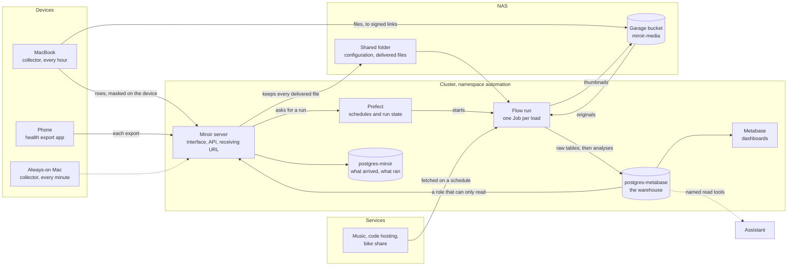
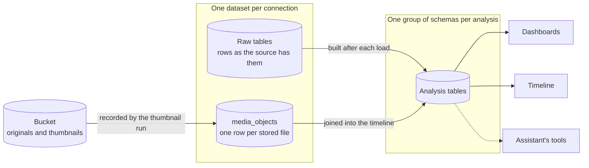

# Data warehouse (Miroir)

Every service and device you use, mirrored into one Postgres, so the data
outlives each service's own retention and can be joined across sources. Miroir
is the program that receives, loads and models it. Its code is in
[h-wb/pipelines](https://github.com/h-wb/pipelines); this page is what is
deployed here and how the parts fit across the three repos. Where it sits in the
whole system is on [the handbook](https://github.com/h-wb/handbook).

| Document                                                                                      | What it holds                                                    |
| --------------------------------------------------------------------------------------------- | ---------------------------------------------------------------- |
| This page                                                                                     | The parts, the sources, where data lives, how to operate it      |
| [docs/flows.md](./docs/flows.md)                                                              | How data moves, one diagram per flow                             |
| [The aware assistant][aware]                                                                  | How the assistant is meant to use the warehouse                  |
| [pipelines: architecture](https://github.com/h-wb/pipelines/blob/main/docs/architecture.md)   | The parts of the code and who may import whom                    |
| [pipelines: Miroir guide](https://github.com/h-wb/pipelines/blob/main/docs/miroir/README.md)  | Configuration, interface, API and commands in full               |
| [pipelines: decisions](https://github.com/h-wb/pipelines/blob/main/docs/miroir/decisions.md)  | Why it is built this way, numbered 001 to 042                    |
| [pipelines: sources](https://github.com/h-wb/pipelines/tree/main/docs/sources)                | One page per source: tables, keys, what is masked                |
| [pipelines: observability](https://github.com/h-wb/pipelines/blob/main/docs/observability.md) | What Miroir knows about each connection; metrics                 |
| [pipelines: releases](https://github.com/h-wb/pipelines/blob/main/docs/releases.md)           | How the collector is versioned                                   |
| dotfiles, `conf.d/macos-miroir-collector/`                                                    | The collector on the MacBook: install, sources, schedule, tokens |

Words used here, as in Miroir:

- A **connection** is one source feeding the warehouse, with its own settings,
  credentials and receiving URL.
- A **dataset** is the raw schema a connection loads into.
- An **analysis** is a package of models built on one or more connections, into
  schemas of its own. Dashboards and the timeline read analyses, never raw
  tables.
- **Media** are files a row points at: a frame's screenshot, a message's
  attachment.
- The **collector** (`miroir-collector`) is the small program on a device that
  reads a local source and delivers it. "Agent" always means an AI agent.

## The map

A solid arrow works today; a dashed arrow is planned.



## The parts

| Part                 | Its job                                                                                                                                                               | Runs as                                               | Defined in                                                                         |
| -------------------- | --------------------------------------------------------------------------------------------------------------------------------------------------------------------- | ----------------------------------------------------- | ---------------------------------------------------------------------------------- |
| Collector            | On a device: read a local source, mask and withhold, deliver, upload files, report                                                                                    | A launchd job, hourly                                 | Code: pipelines `collector/`. Install: dotfiles                                    |
| Server               | Interface, API, receiving URL; signs media links; asks for runs; the timeline                                                                                         | Deployment `miroir`, one container                    | `app/helmrelease.yaml`                                                             |
| Worker               | Turns each requested run into a Kubernetes Job, on the pool `miroir-k8s`                                                                                              | `miroir-worker`, in the Prefect app                   | `../prefect/app/`                                                                  |
| Flow run             | One load, one analysis build or one batch of thumbnails                                                                                                               | A Job from the pinned image, then gone                | `../prefect/app/miroir-job-template.yaml`; the image is named in the configuration |
| Prefect              | Schedules, queues and run state. Miroir decides what a load is; Prefect only runs it                                                                                  | Prefect server                                        | `../prefect/`                                                                      |
| Metadata database    | What arrived and what ran: operations, attempts, the registry of delivered files, connection secrets (encrypted), delivery tokens, collector reports, the media queue | CNPG cluster `postgres-miroir`                        | `ks.yaml` (component `cnpg/initdb`)                                                |
| Warehouse            | The data: one raw dataset per connection, one group of schemas per analysis                                                                                           | CNPG cluster `postgres-metabase`, database `metabase` | `../metabase/`                                                                     |
| Media store          | Screenshots, attachments and their thumbnails                                                                                                                         | Garage bucket `miroir-media`, on the NAS              | `docker/truenas/` (`garage:bootstrap`)                                             |
| Configuration, files | `miroir.json` (connections, analyses, image, media settings) and every delivered file, kept as received                                                               | A NAS export, mounted at `/miroir/data`               | Not in git                                                                         |
| Dashboards           | One collection per source, reading analysis schemas                                                                                                                   | Metabase                                              | `../metabase/`; the dashboards live in Metabase                                    |

Two databases, on purpose: `postgres-miroir` holds Miroir's own bookkeeping,
with the encrypted credentials and the delivery tokens; `postgres-metabase`
holds the data. Flow runs write to both; nothing else writes to the warehouse.

## Sources

| Connection        | Source                         | How it arrives                                    | When           | Dataset             | Analyses               | Media                        |
| ----------------- | ------------------------------ | ------------------------------------------------- | -------------- | ------------------- | ---------------------- | ---------------------------- |
| `listenbrainz`    | Every listen                   | Fetched from the service                          | Daily          | `listenbrainz_data` | `music`, `crossovers`  |                              |
| `github`          | Commits, pull requests, issues | Fetched from the service                          | Daily          | `github_data`       | `github`               |                              |
| `bikeshare`       | Every rental                   | Fetched from the service                          | Daily          | `bikeshare_data`    | `biking`, `crossovers` |                              |
| `health`          | Health metrics and workouts    | The phone's export app posts to the receiving URL | On each export | `apple_health_data` | `health`, `crossovers` |                              |
| `browser_macbook` | Browser history                | Collector, source `zen_history`                   | Hourly         | Generated           | `browser`, `timeline`  |                              |
| `screen_macbook`  | Screen text and the front app  | Collector, source `screenmemory`                  | Hourly         | Generated           | `timeline`             | Screenshots, with thumbnails |
| `messages`        | Messages, chats, attachments   | Collector, source `apple_messages`                | Hourly         | Generated           | `messages`             | Attachments                  |

- **Three ways in.** Miroir fetches from a service's API; or something hands it
  a file, by upload in the interface, by a post to the connection's receiving
  URL, or through a watched folder. The collector is a client of the receiving
  URL, not a way of its own.
- **Merge, never append.** Every table has a key from the source itself (a
  message's own id, a frame's image path), so fetching a window again, sending
  history twice or restoring a device changes nothing.
- **The warehouse keeps what services forget.** A merge never deletes, so rows
  a service or an app expires stay.
- **Location is not here.** The location service keeps that record; nothing
  loads it into the warehouse yet.

## Where data lives



| What                  | Name                                                                      | Notes                                                                              |
| --------------------- | ------------------------------------------------------------------------- | ---------------------------------------------------------------------------------- |
| A dataset, generated  | `ws_<n>_<miroir id>_<connection id>`                                      | `<n>` is the length of the installation's id                                       |
| A dataset, bound      | `listenbrainz_data`, `github_data`, `apple_health_data`, `bikeshare_data` | The connections that took over the loads that existed before Miroir                |
| An analysis's schemas | `miroir_<analysis id>_<hash>_<group>`                                     | One schema per model group; the hash keeps two installations apart                 |
| A stored file         | `<prefix>/<connection>/<kind>/<key>` in the bucket                        | The key is a column of a raw row, so the row and its file are tied by construction |
| A thumbnail           | The same path with `screenshots.w360` or `screenshots.w1280` as the kind  | WebP, 360 and 1280 pixels wide                                                     |

Analyses, each built by dbt into its own schemas after every load of a
connection it links:

| Package      | Reads (role: connection)                             | Tables                                                                        |
| ------------ | ---------------------------------------------------- | ----------------------------------------------------------------------------- |
| `music`      | music: `listenbrainz`                                | daily, listens, artists, sessions, monthly_top, streaks, on_repeat            |
| `health`     | health: `health`                                     | daily_summary, workout_summary                                                |
| `github`     | github: `github`                                     | commits, pull_requests, issues, issue_comments, releases, contributions       |
| `biking`     | biking: `bikeshare`                                  | rides, stations, routes                                                       |
| `browser`    | browser: `browser_macbook`                           | visits, domains_daily                                                         |
| `crossovers` | health, music, biking                                | daily, listens, rides, nights, correlations, years                            |
| `messages`   | messages: `messages`                                 | conversations, messages, reactions, participants, attachments, daily. No text |
| `timeline`   | screen: `screen_macbook`, browser: `browser_macbook` | screen_frames, events, days, apps                                             |

- An analysis names its inputs explicitly (`inputs` maps a role to a
  connection), its time zone, and its parameters. Several analyses may read one
  connection.
- A failed build leaves the load succeeded and the analysis stale; the
  interface shows which.
- `messages` and `timeline` build at most every ten and five minutes: loads
  inside that window share one build at its end.
- Who can read: the owner role, which flow runs write with, and
  `miroir_timeline`, a role that can only read the timeline's tables, with a
  time limit per query (`app/timeline-reader.yaml`). Metabase connects to the
  same database.

## Privacy

The warehouse is private scope as a whole
([the rule](https://github.com/h-wb/handbook#the-one-rule)). Screen text, screenshots and
messages are the most private data in the house.

| Line of defence            | What it does                                                                                                                                                                                                  |
| -------------------------- | ------------------------------------------------------------------------------------------------------------------------------------------------------------------------------------------------------------- |
| On the device              | Known secret shapes are masked by fixed rules and a pinned scanner; frames from password managers are withheld, and their screenshots never uploaded. The collector masks and withholds, and never interprets |
| One token per connection   | A delivery token can only add data to its own connection. A stolen device cannot read anything                                                                                                                |
| No storage key on a device | Files go to links the server signs for a few minutes                                                                                                                                                          |
| Internal route only        | `miroir.${SECRET_DOMAIN}` is on the internal gateway. A device delivers from the LAN or the VPN, and keeps its batch until it can                                                                             |
| Analyses withhold          | The `messages` tables hold lengths and flags, no text. Only `timeline.screen_frames` indexes screen text                                                                                                      |
| Tools per scope            | Metabase's tools belong on the private and assistant tool gateways only                                                                                                                                       |
| Models                     | Only trusted models read warehouse data. General agents work on Miroir's code with made-up fixtures, and on counts and schema at most                                                                         |

Known limits:

- Masking is not anonymising. A password typed in plain view matches no rule,
  and a screenshot cannot be masked at all.
- Screenshots and attachments sit unencrypted in Garage's data folder, and in
  its offsite copy.
- A temporary Metabase entry on the general tool gateway, added for the
  2026-11 cross-checks (counts and schema only), is being removed.
- pipelines and home-ops are public repos: no personal export, address or
  count belongs in either.

## Deployment

**The image.** The server is not released; it ships as
`ghcr.io/h-wb/pipelines:sha-<commit>`. The same tag is named in three places,
and they move together:

| Where                                               | For            |
| --------------------------------------------------- | -------------- |
| `app/helmrelease.yaml`                              | The server     |
| `../prefect/app/helmrelease.yaml` (`miroir-worker`) | The worker     |
| `deployment.image` in `miroir.json`                 | Every flow run |

Pin `sha-` tags only: the registry mirror in the cluster can serve a stale
`main` or `latest`.

**Secrets.**

| Secret                   | From                                                                  | Holds                                                                                                                                                                             |
| ------------------------ | --------------------------------------------------------------------- | --------------------------------------------------------------------------------------------------------------------------------------------------------------------------------- |
| `miroir-secret`          | Bitwarden item `miroir` (created by the Prefect app's ExternalSecret) | `MIROIR_SECRET_KEY` (encrypts connection secrets), `MIROIR_API_TOKEN` (interface and API), `MIROIR_METRICS_TOKEN`, `MIROIR_MEDIA_ACCESS_KEY_ID`, `MIROIR_MEDIA_SECRET_ACCESS_KEY` |
| `prefect-secret`         | Bitwarden item `prefect`                                              | The Prefect API login                                                                                                                                                             |
| `postgres-miroir-app`    | Generated by CNPG                                                     | The metadata database login                                                                                                                                                       |
| `postgres-metabase-app`  | Generated by CNPG                                                     | The warehouse login, for flow runs                                                                                                                                                |
| `miroir-timeline-reader` | Generated once                                                        | The password of the role `miroir_timeline`                                                                                                                                        |
| On each device           | Proton Pass, item `miroir-collector`                                  | One delivery token per connection, read by fnox when the collector runs                                                                                                           |

Credentials of the services Miroir fetches from are entered in its interface
and stored encrypted in the metadata database.

**Storage and backups.**

| What                           | Where                           | Backup                                |
| ------------------------------ | ------------------------------- | ------------------------------------- |
| Warehouse                      | `postgres-metabase`             | Barman to Garage, daily, kept 30 days |
| Metadata                       | `postgres-miroir`               | Barman to Garage, daily, kept 30 days |
| Configuration, delivered files | The NAS export, under `miroir/` | The NAS's own                         |
| Media                          | The bucket `miroir-media`       | Garage's offsite copy                 |
| Dashboards                     | Metabase's own volume           | kopiur, hourly                        |
| Prefect's run history          | Prefect's volume                | kopiur, hourly                        |

**Monitoring.** The server exposes `/metrics`, scraped every minute. Each
collector reports after every run, in fixed words and counts and never data, so
Miroir can tell a quiet source from a broken one. Three alerts
(`app/prometheusrule.yaml`):

| Alert                          | Fires when                                                   |
| ------------------------------ | ------------------------------------------------------------ |
| `MiroirCollectorFailing`       | A collector failed more than twice in a row                  |
| `MiroirCollectorSourceChanged` | Its last run met rows it could not read, or a changed layout |
| `MiroirCollectorSilent`        | No report for three days                                     |

## Operating it

Day to day, the interface at `miroir.${SECRET_DOMAIN}` shows each connection's
last load and each analysis's last build, and can sync, rebuild and rebuild
from scratch. The commands below are for what the interface does not do. The
CLI runs in the server's pod:

```sh
kubectl -n automation exec deploy/miroir -- /app/.venv/bin/python -m src.cli \
  --config /miroir/data/miroir/miroir.json <command>
```

**Roll out a new image.**

1. Wait for the image build of the commit on pipelines' main.
2. If the metadata schema changed (the pull request says so): let running loads
   finish first. An older program refuses a newer schema, and there is no way
   back without a restore.
3. Change the tag in `app/helmrelease.yaml` and in the worker, in one pull
   request, and merge it.
4. Set the same tag in `deployment.image` and apply the deployments (the
   button in the interface, or `deployments apply`).
5. Check that the server is ready, that one load runs on the new image, and
   that `deployments plan` has nothing left to change.

**Add a source on a device.**

1. Create the connection in the interface; it shows a delivery token once.
2. Put the token in Proton Pass, as a field of `miroir-collector`.
3. Add the source to the collector's configuration in dotfiles, with its
   receiving URL.
4. Run the collector once with `--max-batches` raised for the history, then let
   the hourly job carry on.

**Add an analysis.** Add it to `analyses` in the configuration with its inputs,
time zone and parameters; build it; then sync the database schema in Metabase
so the new tables show.

**Make thumbnails for files stored earlier.**

```sh
... media-backfill <connection> <kind> --limit 20000
```

The next run continues where this one stopped. `--retry` takes the failed
ones again; `--retry failed,unreadable` those two kinds.

**When something looks wrong.**

| Symptom                    | Look at                                                                               |
| -------------------------- | ------------------------------------------------------------------------------------- |
| A source stopped arriving  | The connection's page (last delivery, last report); the collector's log on the device |
| A load failed              | The run in Prefect; `refresh` closes runs that ended without an outcome               |
| A dashboard is stale       | The analysis's page: a failed build leaves the load fine and the analysis stale       |
| Builds queue but never run | The Prefect concurrency limit `dbt` (one at a time) must exist                        |
| A device cannot deliver    | It is off the LAN and the VPN; the batch waits in its spool                           |

## State

Done:

- Every source that existed before Miroir loads through a Miroir connection,
  and its dashboards read analysis schemas (2026-11-11 to 2026-11-22). The old
  schemas and the flow that built them are gone.
- The collector, with masking, a scanner, re-sends without duplicates, media
  uploads and a report after each run (2026-11-20, 2026-11-21).
- Screen text and screenshots, browser history and messages from the MacBook.
- Thumbnails for every screenshot.
- Dashboards in one collection per source, Messages included.
- The timeline inside Miroir, for screen and browser: a day view with a
  scrubber, and search over screen text (2026-11-23).

In progress:

- Conversations in the timeline: the data first, then attachments, then the
  pages.
- Messages from the always-on Mac, every minute.

Next:

- Every source on one time axis.
- A contacts source, so the same person lines up across chat networks.
- Checks on the data itself: the share of unreadable or skipped rows per
  source, and tests against each new version of the apps the collector reads.
- The read tools the assistant needs ([The aware assistant][aware]).

Later: other chat networks, the log feed, the live path's history as a source.

[aware]: https://github.com/h-wb/handbook/blob/main/Plans/The%20aware%20assistant.md
