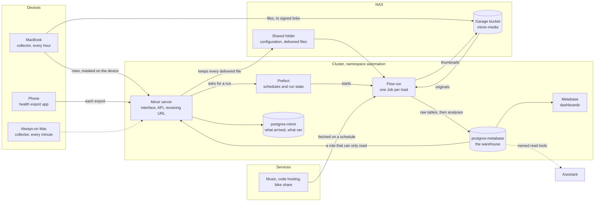

# Miroir deployment

Miroir mirrors every source into one Postgres, the [warehouse](https://github.com/h-wb/handbook/blob/main/Systems/Warehouse.md). Its code and its own documentation are in [h-wb/pipelines](https://github.com/h-wb/pipelines); this page is what is deployed here and how to operate it.

| Document                                                                                         | What it holds                                                                                 |
| ------------------------------------------------------------------------------------------------ | --------------------------------------------------------------------------------------------- |
| [pipelines: flows](https://github.com/h-wb/pipelines/blob/main/docs/miroir/flows.md)             | How data moves, one diagram per flow                                                          |
| [pipelines: operations](https://github.com/h-wb/pipelines/blob/main/docs/operations.md)          | Adding a source or an analysis, builds, what to look at when something is wrong               |
| [pipelines: architecture](https://github.com/h-wb/pipelines/blob/main/docs/architecture.md)      | The parts of the code, the ways data gets in, the words used                                  |
| [pipelines: Miroir reference](https://github.com/h-wb/pipelines/blob/main/docs/miroir/README.md) | What Miroir is; configuration, runs, analyses, media, timeline and API on the pages beside it |
| [pipelines: decisions](https://github.com/h-wb/pipelines/blob/main/docs/miroir/decisions.md)     | Why it is built this way, numbered                                                            |
| [pipelines: sources](https://github.com/h-wb/pipelines/tree/main/docs/sources)                   | One page per source: tables, keys, what is masked                                             |
| [pipelines: observability](https://github.com/h-wb/pipelines/blob/main/docs/observability.md)    | What Miroir knows about each connection; metrics                                              |
| dotfiles, `conf.d/macos-miroir-collector/`                                                       | The collector on the MacBook: install, sources, schedule, tokens                              |

A connection is one source feeding the warehouse; an analysis is a dbt package built on connections into schemas of its own; the collector (`miroir-collector`) runs on a device and delivers a local source.

## The map

A solid arrow works today. The two dashed arrows are not in place: the always-on Mac's collector (HOMEL-2) and the assistant's read tools (HOMEL-49).



## The parts

| Part                 | Its job                                                                                                                                                               | Runs as                                               | Defined in                                                                         |
| -------------------- | --------------------------------------------------------------------------------------------------------------------------------------------------------------------- | ----------------------------------------------------- | ---------------------------------------------------------------------------------- |
| Collector            | On a device: read a local source, mask and withhold, deliver, upload files, report                                                                                    | A launchd job, hourly                                 | Code: pipelines `collector/`. Install: dotfiles                                    |
| Server               | Interface, API, receiving URL; signs media links; asks for runs; the timeline                                                                                         | Deployment `miroir`, one container                    | `app/helmrelease.yaml`                                                             |
| Worker               | Turns each requested run into a Kubernetes Job, on the pool `miroir-k8s`                                                                                              | `miroir-worker`, in the Prefect app                   | `../prefect/app/`                                                                  |
| Flow run             | One load, one analysis build or one batch of thumbnails                                                                                                               | A Job from the pinned image, then gone                | `../prefect/app/miroir-job-template.yaml`; the image is named in the configuration |
| Prefect              | Schedules, queues and run state. Miroir decides what a load is; Prefect only runs it                                                                                  | Prefect server                                        | `../prefect/`                                                                      |
| Metadata database    | What arrived and what ran: operations, attempts, the registry of delivered files, connection secrets (encrypted), delivery tokens, collector reports, the media queue | CNPG cluster `postgres-miroir`                        | `ks.yaml` (component `cnpg/initdb`)                                                |
| Warehouse            | The data: one raw dataset per connection, one group of schemas per analysis                                                                                           | CNPG cluster `postgres-metabase`, database `metabase` | `../metabase/`                                                                     |
| Media store          | Screenshots, attachments and their thumbnails                                                                                                                         | Garage bucket `miroir-media`, on the NAS              | `docker/truenas/` (`garage:bootstrap`)                                             |
| Configuration, files | `miroir.json` (connections, analyses, image, media settings) and every delivered file, kept as received                                                               | A NAS export, mounted at `/miroir/data`               | Not in git                                                                         |
| Dashboards           | One collection per source, reading analysis schemas                                                                                                                   | Metabase                                              | `../metabase/`; the dashboards live in Metabase                                    |

Two databases, on purpose: `postgres-miroir` holds Miroir's own bookkeeping,
with the encrypted credentials and the delivery tokens; `postgres-metabase`
holds the data. Flow runs write to both; nothing else writes to the warehouse.

## Connections

Which connections exist, their schedules and the analyses they feed are configuration, not deployment: `miroir.json` holds them, the interface at `miroir.${SECRET_DOMAIN}` edits it, and no repo keeps a copy. Read them there.

- What feeds the warehouse, source by source: the [handbook's map](https://github.com/h-wb/handbook/blob/main/Map.md).
- How each source is read, its tables and what is masked: [pipelines: sources](https://github.com/h-wb/pipelines/tree/main/docs/sources).

## Privacy here

The warehouse is private scope as a whole ([the one rule](https://github.com/h-wb/handbook#the-one-rule)); masking on the device is described in pipelines. What this deployment adds:

- `miroir.${SECRET_DOMAIN}` is on `envoy-internal` only. A device delivers from the LAN or the VPN and keeps its batch until it can.
- A delivery token can only add data to its own connection. A device holds no storage key: files go to links the server signs for a few minutes.
- The timeline reads the warehouse as `miroir_timeline`, a role that can only read the timeline's tables, with a time limit per query (`app/timeline-reader.yaml`).
- Metabase's tools belong on the private and assistant tool gateways only. The temporary `metabase` entry on the general gateway, for the 2026-11 cross-checks (counts and schema only), is removed by home-ops#5130.
- Screenshots and attachments sit unencrypted in Garage's data folder and in its offsite copy.
- pipelines and home-ops are public: no personal export, address or count belongs in either.

## Deployment

### The image

The server is not released; it ships as
`ghcr.io/h-wb/pipelines:sha-<commit>`. The same tag is named in three places,
and they move together:

| Where                                               | For            |
| --------------------------------------------------- | -------------- |
| `app/helmrelease.yaml`                              | The server     |
| `../prefect/app/helmrelease.yaml` (`miroir-worker`) | The worker     |
| `deployment.image` in `miroir.json`                 | Every flow run |

Pin `sha-` tags only: the registry mirror in the cluster can serve a stale
`main` or `latest`.

### Secrets

| Secret                   | From                                                                      | Holds                                                                                                                                                                             |
| ------------------------ | ------------------------------------------------------------------------- | --------------------------------------------------------------------------------------------------------------------------------------------------------------------------------- |
| `miroir-secret`          | Bitwarden item `miroir` (created by the Prefect app's ExternalSecret)     | `MIROIR_SECRET_KEY` (encrypts connection secrets), `MIROIR_API_TOKEN` (interface and API), `MIROIR_METRICS_TOKEN`, `MIROIR_MEDIA_ACCESS_KEY_ID`, `MIROIR_MEDIA_SECRET_ACCESS_KEY` |
| `miroir-media`           | Bitwarden item `miroir` (the Prefect app's `miroir-media` ExternalSecret) | The two `MIROIR_MEDIA_*` keys alone, for the job template's `env_from` variable: only a deployment that names it gets the bucket key                                              |
| `prefect-secret`         | Bitwarden item `prefect`                                                  | The Prefect API login                                                                                                                                                             |
| `postgres-miroir-app`    | Generated by CNPG                                                         | The metadata database login                                                                                                                                                       |
| `postgres-metabase-app`  | Generated by CNPG                                                         | The warehouse login, for flow runs                                                                                                                                                |
| `miroir-timeline-reader` | Generated once                                                            | The password of the role `miroir_timeline`                                                                                                                                        |
| On each device           | Proton Pass, item `miroir-collector`                                      | One delivery token per connection, read by fnox when the collector runs                                                                                                           |

Credentials of the services Miroir fetches from are entered in its interface
and stored encrypted in the metadata database.

To call the API from a workstation, the token is `MIROIR_API_TOKEN` in the Bitwarden item `miroir`: read it with `mise run //docker/truenas:bws`, whose own token comes from Proton Pass through fnox ([secret tools](../../external-secrets/external-secrets/app/README.md#bootstrap-and-local-secret-tools)). Keep it in the process's memory, not in a file. A workshop pod cannot read Kubernetes Secrets.

### Storage and backups

| What                           | Where                           | Backup                                |
| ------------------------------ | ------------------------------- | ------------------------------------- |
| Warehouse                      | `postgres-metabase`             | Barman to Garage, daily, kept 30 days |
| Metadata                       | `postgres-miroir`               | Barman to Garage, daily, kept 30 days |
| Configuration, delivered files | The NAS export, under `miroir/` | The NAS's own                         |
| Media                          | The bucket `miroir-media`       | Garage's offsite copy                 |
| Dashboards                     | Metabase's own volume           | kopiur, hourly                        |
| Prefect's run history          | Prefect's volume                | kopiur, hourly                        |

### Monitoring

The server exposes `/metrics`, scraped every minute. Each
collector reports after every run, in fixed words and counts and never data, so
Miroir can tell a quiet source from a broken one. Three alerts
(`app/prometheusrule.yaml`):

| Alert                          | Fires when                                                   |
| ------------------------------ | ------------------------------------------------------------ |
| `MiroirCollectorFailing`       | A collector failed more than twice in a row                  |
| `MiroirCollectorSourceChanged` | Its last run met rows it could not read, or a changed layout |
| `MiroirCollectorSilent`        | No report for three days                                     |

## Operating it

Day to day, the interface at `miroir.${SECRET_DOMAIN}` shows each connection's
last load and each analysis's last build, and can sync, rebuild and rebuild
from scratch. The commands below are for what the interface does not do. The
CLI runs in the server's pod:

```sh
kubectl -n automation exec deploy/miroir -- /app/.venv/bin/python -m src.cli \
  --config /miroir/data/miroir/miroir.json <command>
```

### Roll out a new image

1. Wait for the image build of the commit on pipelines' main.
2. If the metadata schema changed (the pull request says so): let running loads
   finish first. An older program refuses a newer schema, and there is no way
   back without a restore.
3. Change the tag in `app/helmrelease.yaml` and in the worker, in one pull
   request, and merge it.
4. Set the same tag in `deployment.image` and apply the deployments (the
   button in the interface, or `deployments apply`).
5. Check that the server is ready, that one load runs on the new image, and
   that `deployments plan` has nothing left to change.

### Make thumbnails for files stored earlier

```sh
... media-backfill <connection> <kind> --limit 20000
```

The next run continues where this one stopped. `--retry` takes the failed
ones again; `--retry failed,unreadable` those two kinds.

### When something looks wrong

What to look at for a source that stopped arriving, a failed load or a stale dashboard is in [pipelines: operations](https://github.com/h-wb/pipelines/blob/main/docs/operations.md#when-something-looks-wrong). On the cluster side:

| Symptom                    | Look at                                                                  |
| -------------------------- | ------------------------------------------------------------------------ |
| Builds queue but never run | The Prefect concurrency limit `dbt` (one at a time) must exist           |
| A device cannot deliver    | `miroir.${SECRET_DOMAIN}` is on `envoy-internal` only: LAN or VPN        |
| A flow run never starts    | The worker `miroir-worker` in the Prefect app, and its pool `miroir-k8s` |
