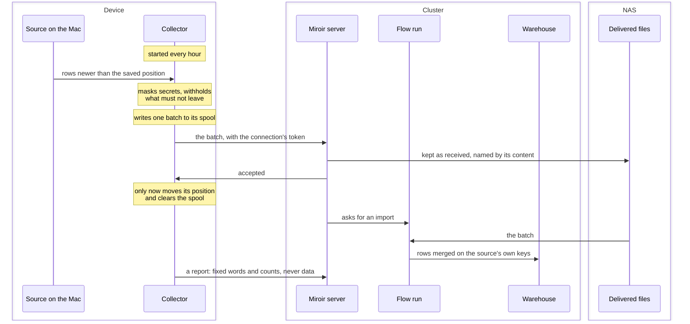
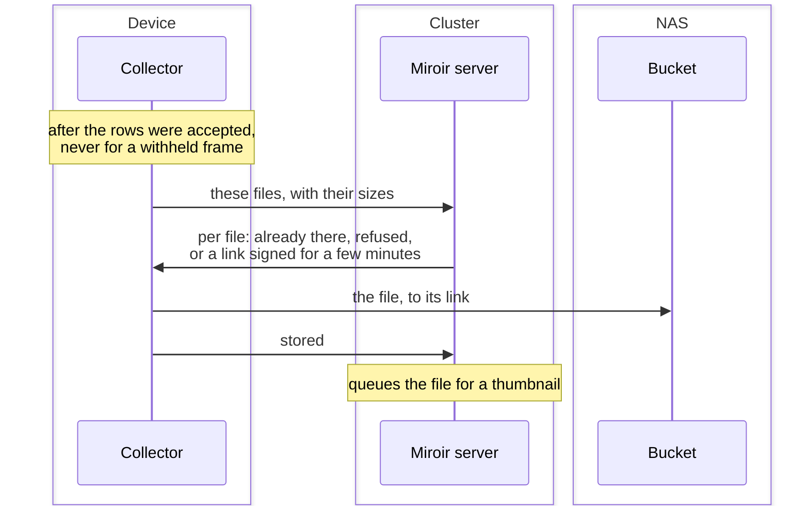
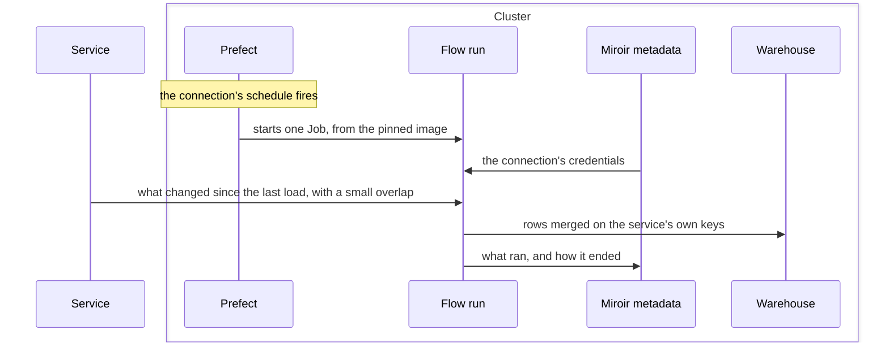
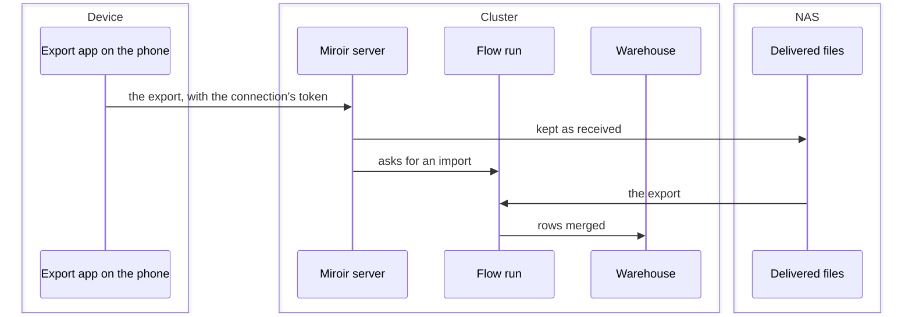
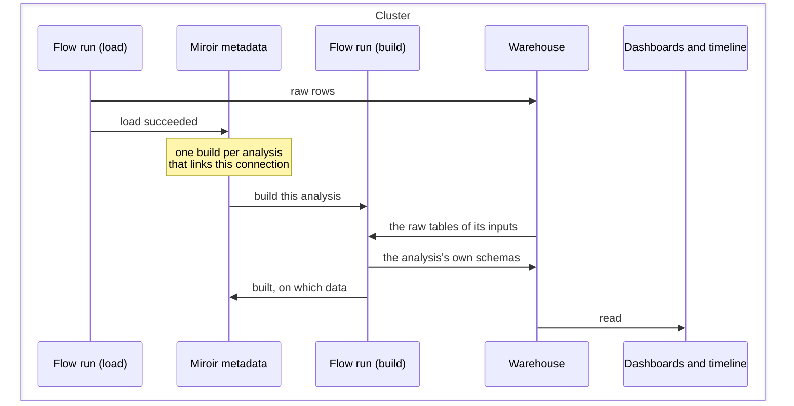
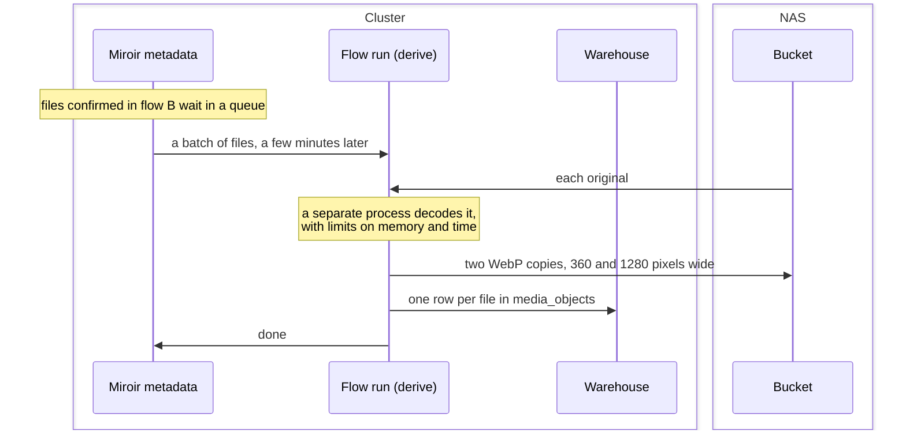
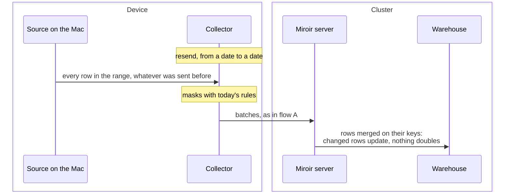
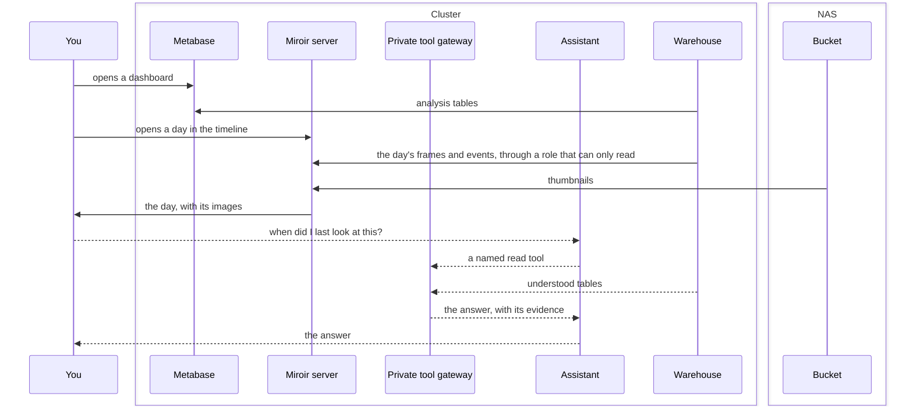

# Flows

How data moves into and out of the warehouse. The parts are described in
[the warehouse page](../README.md); the rules behind each flow are in
[pipelines' decisions](https://github.com/h-wb/pipelines/blob/main/docs/miroir/decisions.md),
named here by number.

Every flow uses the same columns, in the same order: the device on the left,
the cluster in the middle, the NAS on the right. A flow shows only the columns
it uses.

- A solid arrow works today. A dashed arrow is planned.
- An arrow shows where information moves.
- GitHub draws these diagrams from the text in the page.

## A. A device delivers rows

Status: works today

The collector on a Mac reads what is new in a local source, removes what must
not leave, and hands one file to Miroir. Screen text, browser history and
messages all arrive this way (decisions 030, 032, 034, 038).

The source is opened read-only, and the collector sends rows as they are: no
cleaning, no joining, no summary. Masking is the one change it makes, by fixed
rules and a pinned scanner, never by a model.

- What guarantees it: the position moves only after Miroir accepts the batch,
  so a batch that did not arrive is sent again on the next run. The same bytes
  are the same file, and rows merge on keys, so a batch that arrives twice
  changes nothing. A token can only add to its own connection.
- What it costs: the warehouse is up to an hour behind. A masked value is
  gone from the warehouse for good; a better rule means sending that range
  again from the source, while the source still has it. Each delivery starts
  one Job.

## B. A file that a row points at

Status: works today

A frame has a screenshot and a message has attachments. Those files are not
parsed, so they do not go through the path above: they go straight to the
bucket (decision 033).

The file's name in the bucket comes from a column of its row, so the row and
the file are tied by construction and need no lookup table.

- What guarantees it: the device never holds a storage key. A link is good for
  one file and a few minutes. A file that is already there is not sent again,
  so an interrupted upload resumes where it stopped.
- What it costs: a screenshot cannot be masked. The bucket is private, and
  viewing a file needs a login to Miroir. A file that is not on the device
  (an attachment still in the cloud) is simply missing until it is.

## C. A service is fetched

Status: works today

For a service with an API, nothing runs on a device. Prefect starts a load on
the connection's schedule (decisions 012, 013, 021).

- What guarantees it: reading an overlap again is harmless, because rows
  merge. One load at a time per connection.
- What it costs: a service that expires data faster than the schedule loses
  rows; daily is enough for the ones connected today.

## D. An app pushes an export

Status: works today

The phone's health export app posts each export to the connection's receiving
URL. It is flow A without a collector: the same door, the same token rule, the
same import (decision 017).

A file can also be uploaded by hand in the interface, or left in a watched
folder. All three ways register the file first and import it second, so any
file can be imported again later with a newer parser.

## E. From a load to tables you read

Status: works today

Raw tables mirror the source. Everything that interprets them (who is "me",
local days, sessions, counts) is a model in an analysis, built after each load
(decisions 022, 040, 042).

- What guarantees it: an analysis writes only into its own schemas, so two
  analyses never collide. A failed build leaves the load succeeded and marks
  the analysis stale. Builds run one at a time.
- What it costs: a busy source would build constantly, so `messages` and
  `timeline` build at most every ten and five minutes; loads inside that
  window share one build. A model that changes shape needs "rebuild from
  scratch".

## F. Thumbnails

Status: works today, for screenshots

Scrubbing through a day needs small images. A run makes them once, a few
minutes after files arrive (decision 040).

`media_objects` is how a model knows whether a file exists and whether it has
a thumbnail, without asking the bucket. Files stored before this existed are
walked by `media-backfill`.

- What guarantees it: the decoder proves itself on built-in images before it
  touches a file, so a broken decoder stops the run rather than marking files
  as failed. One bad file costs one row, not the batch.
- What it costs: attachments have no thumbnails yet, and nothing decodes HEIC
  or video.

## G. Sending something again

Status: works today

A restore, a second Mac with the same messages, a new masking rule, a gap to
repair: all are the same flow as A, started by hand for a range of dates
(decision 034, 038).

- What guarantees it: keys are the source's own ids (a message's id, a frame's
  image path), never row numbers of one database, so the same thing from two
  devices or two backups is one row.
- What it costs: it only works while the source still holds the range.

## H. Reading

Three readers, one rule: read analyses, not raw tables.

| Reader     | Status      | Reads                                                                           |
| ---------- | ----------- | ------------------------------------------------------------------------------- |
| Dashboards | Works today | Every analysis; one collection per source                                       |
| Timeline   | Works today | The `timeline` analysis and thumbnails: screen and browser. Conversations next  |
| Assistant  | Planned     | Named tools over understood tables: [Awareness](../../../llm/docs/awareness.md) |

- What guarantees it: the timeline's role can read only the timeline's tables
  and is cut off after a few seconds. Images are served behind Miroir's login.
  The assistant gets tools, never a database connection.
- What it costs: a dashboard is as fresh as the last build, not the last
  load.
