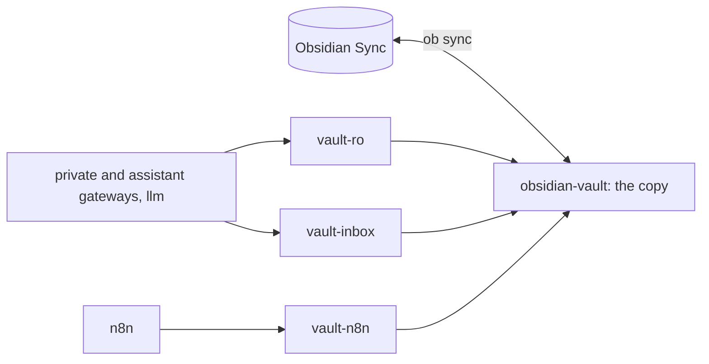

# Obsidian vault

A copy of the vault that Obsidian Sync keeps up to date both ways, with no
Obsidian app running. Anything written into it reaches every device.

- `obsidian-vault` (`app/helmrelease.yaml`) runs the official `ob` CLI. It may
  reach only Obsidian's servers, and nothing may reach it.
- Seekstone (`app/seekstone.yaml`) reads and writes the files directly. A write
  on this volume is a local change, so `ob sync` uploads it.
  - `vault-ro` reads everything.
  - `vault-inbox` writes `Notes/`, `AI/` and `Archives/`: the assistant, each
    write approved in chat.
  - `vault-n8n` writes `Notes/` and `References/`, and sees only those plus
    `Categories/` and `Templates/`: the journal and place-note workflows.
- Who may call each one is `app/networkpolicy.yaml`. The private and
  assistant gateways list `vault-ro` and `vault-inbox` through MCPServerEntries
  of the same names in `llm/toolhive/mcp-servers/vault`, so tool names never
  changed with the move. n8n calls `vault-n8n` directly; no gateway lists it.
- The servers mount the same block volume, so they run on the sync pod's node.
- Kopiur snapshots the volume hourly. The volume holds the vault, `ob`'s state
  and Seekstone's audit logs (`seekstone/`). Obsidian Sync stays the vault's
  source: a new volume fills from it, as a new device.
- The sync's credentials are the `obsidian-headless` Bitwarden item.
