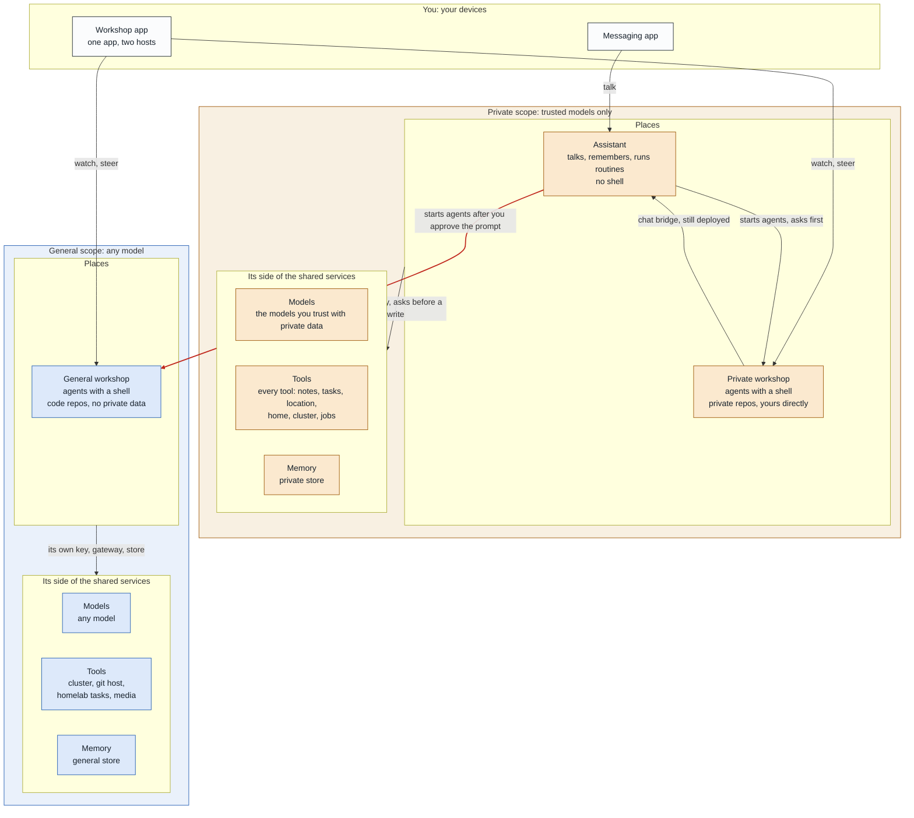

# Models, tools and memory

What is deployed. The rule it enforces, the roles and the decisions behind it are in the
[handbook](https://github.com/h-wb/handbook): its start page, the system pages and
[Decisions](https://github.com/h-wb/handbook/tree/main/Decisions). The rest of the documentation here:

| Document                               | What it holds                                                         |
| -------------------------------------- | --------------------------------------------------------------------- |
| [docs/flows.md](./docs/flows.md)       | How work moves, one diagram per flow                                  |
| [docs/wiring.md](./docs/wiring.md)     | How each agent connects today, and where that differs from the design |
| [paseo/README.md](./paseo/README.md)   | The two workshops: pods, config, credentials, volumes                 |
| [hermes/README.md](./hermes/README.md) | The assistant: messaging, dashboard, credentials and Matrix setup     |

Use general and private as data scopes, as in
[the handbook's one rule](https://github.com/h-wb/handbook#the-one-rule). General includes
operational secrets and code; private includes personal notes, location, health and memory.
Private data only reaches models trusted with it, today those served by Mistral's API (Mistral
and GLM) and local inference; Claude and ChatGPT work on general data only. Moving a model from
one list to the other is one change, to the model lists on the keys.

Scopes are enforced per client: each LiteLLM virtual key lists the models it may
use, each Memini has its own client keys, ToolHive has one gateway per scope, and
each Paseo scope is a separate pod. No private-scope key lists a model outside the trusted set.

| Scope   | Tool endpoint (in-cluster)         | Memory endpoint  | Paseo client key        |
| ------- | ---------------------------------- | ---------------- | ----------------------- |
| General | `mcp-general` (`vmcp-mcp-general`) | `memini-general` | `litellm-paseo-general` |
| Private | `mcp-private` (`vmcp-mcp-private`) | `memini-private` | `litellm-paseo-private` |

The assistant has a third endpoint on the private side, `vmcp-mcp-assistant`: the
same catalogue without the search optimizer, because Hermes searches tools itself
and decides per tool name whether to ask first.

ToolHive's gateways take callers anonymously, so who reaches each one is the
boundary. In-cluster clients (Hermes, Paseo) call the service with no
key, and `toolhive/config/networkpolicy.yaml` admits only that scope's pods.
Clients outside the cluster go through Envoy (`mcp-<scope>.${SECRET_DOMAIN}`),
which checks `x-api-key` against that gateway's own list.

Client keys are per holder (what you'd revoke if it leaked), shared by every
agent on it, and named `<SCOPE>_<HOLDER>` in Bitwarden:

| Item       | Fields                                                                                                                                                                                            |
| ---------- | ------------------------------------------------------------------------------------------------------------------------------------------------------------------------------------------------- |
| `toolhive` | `GENERAL_WORKSTATION`, `PRIVATE_WORKSTATION` (Envoy client `workstation`), `REDIS_PASSWORD` (the gateways' session store)                                                                         |
| `memini`   | `GENERAL_ADMIN`, `GENERAL_WORKSTATION`, `GENERAL_PASEO`, `GENERAL_HERMES` and `GENERAL_PASEO_PRIVATE` (both read-only), `PRIVATE_ADMIN`, `PRIVATE_HERMES`, `PRIVATE_WORKSTATION`, `PRIVATE_PASEO` |

The workstation keys reach the workstations through Proton Pass
(`Machines/toolhive`, `Machines/memini`, fields `general`/`private`). The
litellm key is consumed directly: its CR lives beside the pods, so the operator
writes the Secret into the agents namespace and the helmrelease binds it by name.

The assistant also reads `PASEO_PASSWORD` from both workshop items, to start
agents there. The assistant's messaging and dashboard credentials are their own
item, `hermes`; its fields are listed in [Hermes credentials](./hermes/README.md#credentials).

## Places

A place is a filesystem, its credentials and its network reach. Each has one scope, holds only
that scope's credentials, and gets that scope's model key, tool gateway and memory store.

The thick red arrow is the only path by which anything leaves the private scope: a prompt you
read first ([flow D](./docs/flows.md#d-a-coding-job-for-the-general-workshop)).

| Place                | Scope   | Who works there         | Network                                                        |
| -------------------- | ------- | ----------------------- | -------------------------------------------------------------- |
| `hermes-private` pod | Private | The assistant, no shell | Denied by default; model gateway, tools, memory, Matrix, Paseo |
| `paseo-private` pod  | Private | Private workshop agents | Open internet                                                  |
| `paseo` pod          | General | General workshop agents | Open internet, Kubernetes, KubePrism and Talos APIs denied     |
| Workstation          | Mixed   | Agents of both kinds    | Its own                                                        |

Limits of the boundary:

- The workstation is a mixed place: any agent there can read every repo and note on its disk.
  Keep private data out of working trees on it.
- Pasted text is not covered: do not paste private data into a general agent.
- Someone with cluster or Bitwarden admin rights in the general scope can reach private
  workloads. The boundary guards normal workflows, not an administrator.

## Where things live

One place for each kind of thing. A skill is a folder with a `SKILL.md` (the
Agent Skills format), kept in git, so every agent here can read it.

| What                                  | Where                         | Who reads it                                           |
| ------------------------------------- | ----------------------------- | ------------------------------------------------------ |
| A habit true on every machine         | dotfiles, `conf.d/ai/skills/` | Every agent; a Job copies the folder to the assistant  |
| Facts about one repo                  | That repo's `AGENTS.md`       | Whoever opens the repo                                 |
| A procedure for one repo              | That repo's `.agents/skills/` | Whoever opens the repo                                 |
| The assistant's routines and skills   | `hermes/app/routines/`        | The assistant                                          |
| The assistant's standing instructions | `hermes/app/SOUL.md`          | The assistant, in every chat                           |
| What is deployed, and this table      | This file                     | You; the assistant, through its `system-docs` skill    |
| Why it is built this way              | The handbook's `Decisions/`   | You; the assistant, through its `system-docs` skill    |
| Your notes and anything private       | The Obsidian vault            | You; private agents, through the vault tools           |
| How to write in the vault             | The vault's own `AGENTS.md`   | Whoever writes there; the assistant, before each write |
| What agents learn as they work        | Memini, one store per scope   | The agents. Nothing to maintain by hand                |

- Nothing a general agent has to follow lives in the vault. It is private, so
  the general agents could not read it. The vault's `AGENTS.md` only concerns
  agents that write in the vault, and those are private.
- The assistant writes in the vault through `vault-inbox`, limited to
  `Notes/`, `AI/` and `Archives/`; every write asks. The cluster copy syncs
  two ways, so the writes reach every device.
- Claude Code reads `.claude/skills` only. dotfiles links the shared skills
  there as well as into `~/.agents/skills`, which Codex and OpenCode read.
- The assistant has no file tools. It reads these pages from git through the
  GitHub tool, so it always sees the current version and holds no copy.

### Routines

A routine is a skill in `hermes/app/routines/<name>/SKILL.md`. With
`metadata.schedule` (a cron line, on your clock) and `metadata.model` in its
front matter it also gets a scheduled job, delivered to the Inbox room on
Matrix. Without them
it is a skill the assistant loads when the task fits.

To add one, write the folder and add its file to the `hermes-routines`
ConfigMap (`hermes/app/kustomization.yaml`). The pod restarts, and its
`routines` init container lays the skills out and rebuilds the jobs; a job
whose skill is gone is removed. Read that container's log to see it.

## Agent model gateway

Agents use the Service, `http://litellm.llm.svc.cluster.local:4000`, like every other in-cluster client.

| Client      | Route                    | Provider credentials                                                                                                                         |
| ----------- | ------------------------ | -------------------------------------------------------------------------------------------------------------------------------------------- |
| Claude Code | Root URL, `anthropic/*`  | Claude Code owns its subscription login; LiteLLM forwards it. `ANTHROPIC_CUSTOM_HEADERS` carries the LiteLLM key                             |
| OpenCode    | `/v1`, explicit aliases  | LiteLLM owns everything: the shared `chatgpt/*` login, local/Qwen, and Mistral's API (Mistral and GLM models). The pods hold no provider key |
| Codex       | `/v1`, `gpt-*`/`codex-*` | Codex owns its subscription sign-in, LiteLLM forwards it; requests without one ride the shared `chatgpt/*` login                             |
| Hermes      | In-cluster `/v1`         | Private only, its own key, Mistral only                                                                                                      |

Claude's URL and header are injected into general's containers. Keep
`ANTHROPIC_API_KEY`, `ANTHROPIC_AUTH_TOKEN` and `apiKeyHelper` unset. The gateway
holds no Anthropic key, so a request without a subscription token fails rather
than billing. Confirm subscription use with `used_client_oauth_token=true` in
LiteLLM's logs; Claude dollar costs shown there are API-price equivalents, not a
bill. See [Claude subscriptions](https://docs.litellm.ai/docs/tutorials/claude_code_max_subscription).

OpenCode's ChatGPT models are the proxy-owned `chatgpt/*` aliases, sharing one
login and quota with karakeep, lingarr and kritika.

The ChatGPT subscription is also exposed as the wildcard deployments in
`litellm/app/models/subscriptions.yaml` (`gpt-*`, `codex-*`): a Codex client
supplies its own sign-in and LiteLLM forwards it, while a request without one
is served by the shared gateway login. Unlike the `chatgpt/*` aliases they
declare no guards (272k window, per-key fencing), so OpenCode's Sol/Terra
picks use the new aliases in `models/chatgpt.yaml` and the wildcards are left
to Codex-style clients keeping their own sign-in (`codex-*` carries Codex's
own slugs, such as `codex-auto-review`). Both surfaces need LiteLLM >= 1.109.0
(proxy pinned to the latest dev release) and share one subscription quota.
See [ChatGPT subscription](https://docs.litellm.ai/docs/tutorials/openai_codex_byok).

## Preserved identities

Memini app directories use the new names. The releases, PVCs, backup identities
and generated credentials remain `memini-code` (general) and `memini` (private).
Scoped Service aliases point at these existing instances and their UI hostnames
are scoped. No memory database or client key is recreated for naming consistency.
Memini keys do not restrict readable namespaces: keep the stores separate and use
namespaces only to organize projects/agents within each.

ToolHive's gateways are named for their scope (`mcp-general`, `mcp-private`,
`mcp-assistant`); they hold no data, so they were renamed outright. The old
`mcp-ops` hostname still answers. Existing CreatedOnce key sets
are intentionally unchanged to prevent rotating every old client; a retired
Open WebUI key remains inert in the old general key set.

## Execution boundaries

See [Paseo environments](./paseo/README.md). General reaches Kubernetes through
ToolHive; its pod has no service-account token or direct RBAC grants. ToolHive
permissions, GitOps writes and retained bootstrap credentials remain operational
access paths. The tool servers answer only ToolHive's own pods, so the gateways are the only way in.

## Open WebUI retirement

Paseo is the interactive interface. Open WebUI's HelmRelease, app route, stateless Dragonfly
instance, LiteLLM grants, app manifests and presets are removed; Git history keeps them.
`open-webui/ks.yaml` remains a data retention Kustomization: its PostgreSQL cluster, uploaded
files, encryption key, OIDC identity and backups stay managed. Do not remove it until the data
is retired on purpose.
