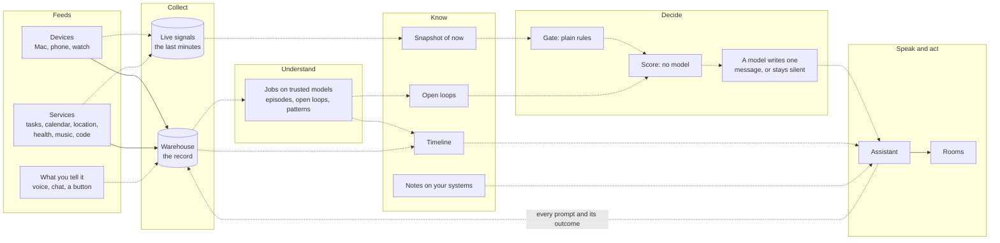
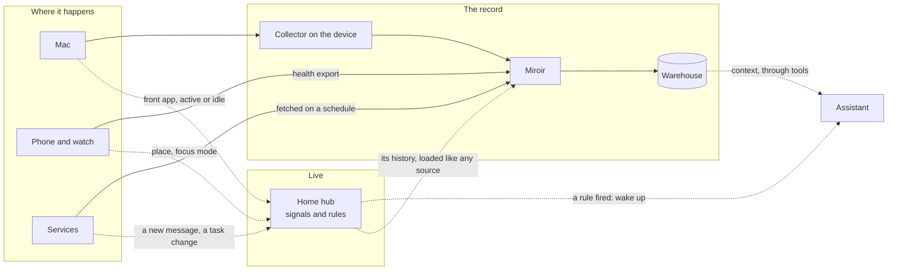
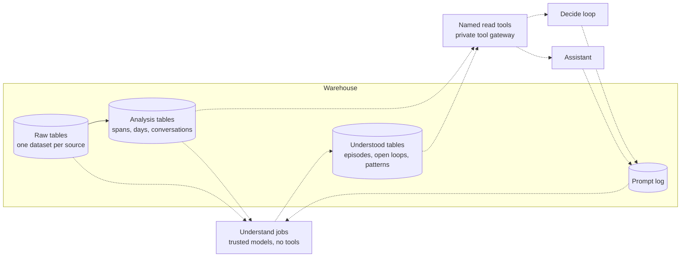
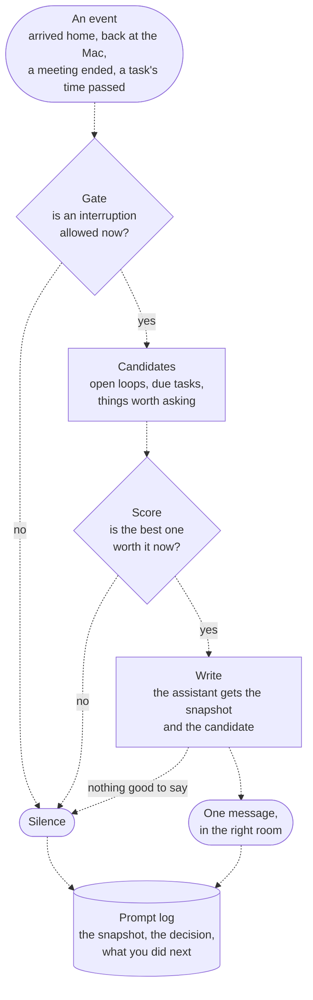
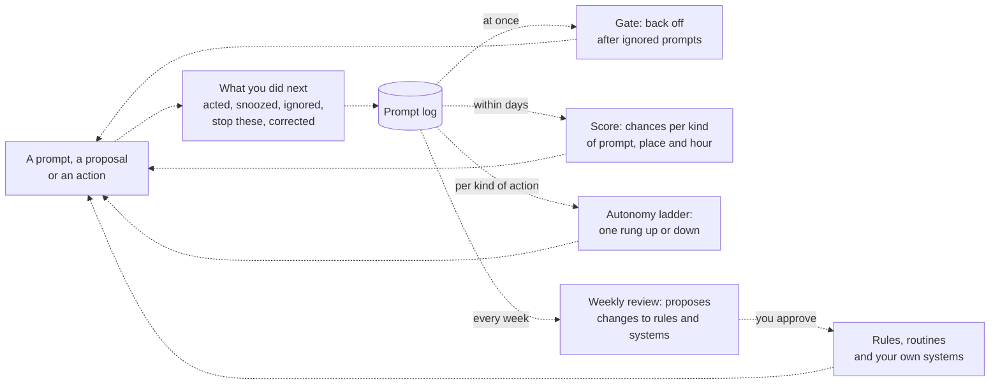

# Awareness: an assistant that knows what is going on

Target design, worked out from 2026-11-19 to 2026-11-22. It extends
[DESIGN.md](../DESIGN.md): that page says who may see what and how the assistant
acts; this one says how the assistant comes to know what you are doing, and how
it decides when to speak.

Most of this page is not built. What exists today is the collecting side: the
[data warehouse](../../automation/miroir/README.md) and the feeds that fill it.
Every section says what works and what is planned, and
[Getting there](#getting-there) lists the order.

In the diagrams a solid arrow works today and a dashed arrow is planned, as in
[flows.md](./flows.md).

## What it is for

The goal, as you stated it:

- **The right moment, not the clock.** A prompt arrives when you can act on it:
  free, in the right place, not in the middle of something.
- **No notification fatigue.** A badly timed assistant gets muted, and then it
  is worth nothing. Staying silent is the default.
- **It knows what happened.** It notices that a task slipped without being
  told, finds out why, and moves it somewhere it can succeed.
- **It learns.** The more it is fed, the better its timing and its proposals.
  Its own mistakes change how it behaves.
- **It knows your systems** (how you plan, file and review) and reviews them
  with you, proposing changes.
- **Telling it something costs nothing.** A sentence to the phone, the watch or
  the chat is enough.

Today every message the assistant starts by itself is clock-driven: a briefing,
a midday nudge, an evening check-in, a weekly review and a reminder poll. Nothing
reacts to an event, and it learns that a task slipped only when you say so.

## The shape

The assistant is not fed everything. The trusted models are the weakest part of
the setup, and no prompt can hold a life. So raw feeds are turned into a small,
current picture underneath the assistant, and a separate piece decides when to
speak. The assistant stays the voice and the hands.

| Layer            | What it does                                                                                 | Built from                                                 | Today                                               |
| ---------------- | -------------------------------------------------------------------------------------------- | ---------------------------------------------------------- | --------------------------------------------------- |
| 1. Collect       | Every feed lands as typed tables, with one owner per feed                                    | The warehouse for the record; a thin live path for signals | The warehouse works; no live path                   |
| 2. Understand    | Trusted models turn raw rows into episodes, facts and open loops                             | Jobs on the job runner, writing back to the warehouse      | Deterministic models only (spans, sessions, counts) |
| 3. Know          | A snapshot of now (about 30 lines), a timeline per day, open loops, notes about your systems | Warehouse tables and the vault, served as tools            | The timeline's data models; no tool serves them yet |
| 4. Decide        | On each event: may I interrupt, what fits this moment, is it worth saying                    | Rules first, a score second, a model last                  | Nothing                                             |
| 5. Speak and act | Rooms, replies, writes through named tools                                                   | The assistant                                              | Works, on a clock                                   |

An open loop is something you promised, were asked, or started and did not
finish: a message you said you would answer, a pull request still open, a task
whose time passed.

## Two paths: the record and the doorbell

Two different needs, so two paths. Making the record faster does not give the
second one, and it is not needed.

|         | The record                                                | Live signals                               |
| ------- | --------------------------------------------------------- | ------------------------------------------ |
| Answers | What happened, what is left open, what usually works      | Is now a good moment, and for what         |
| Holds   | Everything, for good                                      | A handful of values that change the answer |
| Delay   | A minute to an hour                                       | Seconds                                    |
| Kept by | The warehouse (Miroir), or the service that owns the data | The home hub; disposable                   |
| Read by | Understand jobs, the timeline, the weekly review          | The gate and the snapshot                  |
| Today   | Works                                                     | Not built                                  |

Each feed is declared once, with two answers: who keeps the record, and does the
assistant need it now.

| Feed                                    | Record kept by             | In the warehouse today         | Live signal                          |
| --------------------------------------- | -------------------------- | ------------------------------ | ------------------------------------ |
| Screen text and screenshots (Mac)       | Warehouse                  | Yes, hourly                    | Only "which app is in front"         |
| Browser history                         | Warehouse                  | Yes, hourly                    | No                                   |
| Messages (iMessage, SMS)                | Warehouse                  | Yes, hourly; every minute next | A new message arrived                |
| Other chat networks                     | Warehouse                  | No                             | Later                                |
| Health                                  | Warehouse                  | Yes, on each export            | No: it plans the day, not the moment |
| Music, code activity, bike rides        | Warehouse                  | Yes, daily                     | No                                   |
| Location                                | The location service       | No (the service is the record) | Arrivals and departures              |
| Tasks and calendar                      | The task service           | No                             | Changes; busy or free                |
| Phone state (focus, moving, app in use) | Warehouse                  | No                             | Yes                                  |
| What you tell it (the log)              | Warehouse                  | No                             | Yes                                  |
| Agent work in the workshops             | The workshop's own records | No                             | Needs your attention                 |
| Prompts it sent, and what happened next | Warehouse                  | No                             | Time since the last one              |

Rules that came out of building the first feeds:

- **The record is typed tables, not one event table.** Each source keeps its
  own tables in the warehouse. The live side is small and can be thrown away.
- **A feed with a working path keeps it.** The phone already reports to the
  location service; nothing is put in front of that.
- **One implementation per source.** History, new data and a restore all go
  through the same collector into the same tables, keyed by the source's own
  ids, so sending something twice never duplicates it.
- **Secrets stop at the device.** The collector masks and withholds before
  anything leaves; it never interprets. Interpretation happens in the
  warehouse, where it can be rerun over history.

Today: the record side is deployed and described in the
[warehouse page](../../automation/miroir/README.md). The live side is a design.
Its hub would be Home Assistant, which already runs (on the edge cluster), is
already one of the assistant's tool servers, and can hold rules as plain
automations. Its apps are on neither the phone nor the Mac yet; the Mac app
would add the front app and active-or-idle, the phone app place and focus mode. Hermes can
be woken by a web call, but no such route is configured: the assistant's pod
accepts nothing but its dashboard, and its scheduler is the only thing that
starts a run.

## How the assistant uses the warehouse

The warehouse is private scope as a whole: screen text and messages are the most
private data in the house. Only trusted models read from it, and the assistant
is one of their clients. It never gets a database connection or free-form SQL.

- **Reads are named tools on the private gateway**, like everything else the
  assistant does. The ones this design needs:

  | Tool         | Answers                                                               | Reads                         |
  | ------------ | --------------------------------------------------------------------- | ----------------------------- |
  | `now`        | The snapshot: where, what is in front, next event, what is open       | Live signals, tasks, calendar |
  | `day`        | The timeline of one day, as episodes                                  | Understood tables             |
  | `search`     | "When did I look at X", "what did they say about Y"                   | Analysis tables, text indexes |
  | `open_loops` | What is unfinished, with the evidence for each                        | Understood tables             |
  | `patterns`   | What usually works: when a kind of task gets done, which prompts land | Understood tables, prompt log |
  | `log`        | Write one line you told it                                            | The log feed                  |

- **Each tool reads through a role that can only read**, limited to the tables
  it needs and to a few seconds per query. The timeline interface inside Miroir
  already works this way, with a read-only role of its own.
- **It reads understood tables, not raw ones.** A day of raw screen text is far
  too large for one call, and raw text carries other people's words.
- **Understand jobs run on the job runner**, on trusted models through the
  model gateway, and write their results back as tables: per span one line of
  what you were doing, per conversation what is still owed, per habit when it
  usually happens. A job summarises per span first and writes the day from
  those lines.
- **Extraction has no tools.** A message or a page on your screen can carry
  instructions. The step that reads such text can only fill structured fields;
  it cannot call anything.
- **An open loop is checked against later evidence** before the assistant
  raises it. A fix that has since landed, or a reply that was sent from another
  device, closes it.
- **Patterns are written as readable lines** in the vault, for example "Dishes:
  12 of 15 times between 20:00 and 20:30, after dinner". You can correct a line,
  and the correction wins.

Today: none of these tools exist. The warehouse holds the raw tables and the
deterministic analysis tables; dashboards and the timeline interface read them.
The assistant's tool gateway does list the dashboard server's tools, so it could
already query the warehouse through them; nothing in its instructions or
routines does, and that is free-form querying, not the named reads above.
Miroir's own plan ends with this step ("AI analysis", in the
[product plan](https://github.com/h-wb/pipelines/blob/main/docs/product-plan.md)).

## The smart loop: deciding when to speak

One loop, started by an event, that ends in one message or in silence.

1. **The gate is plain rules, no model.** Quiet hours, focus mode on, in a
   meeting, driving, twenty minutes of typing in an editor, a daily budget, a
   minimum gap since the last prompt, and a back-off after ignored prompts. It
   lives in the home hub as automations. This is what prevents fatigue, and it
   cannot be talked out of a rule.
2. **Candidates come from what is known**: open loops, tasks due or slipped,
   one question the assistant is blocked on.
3. **The score needs no model either.** For each candidate: the chance you act
   on it now, times how much it matters, minus what interrupting you costs
   right now. Place, time available, energy and deadline go in; the chances
   come from the prompt log.
4. **A model runs only for a strong candidate.** It gets the snapshot and the
   candidate, and writes one message or declines. Every wake-up is a model call
   on the trusted provider's budget, so the first three steps must keep them
   rare.

Examples of events: back at the Mac after half an hour away, ten minutes in a
browsing app during a block planned for work, arriving home, a meeting that just
ended.

### Decisions as typed questions

Each step of the loop is a question with a fixed answer type: yes or no (may I
interrupt), one of a list (which candidate fits), a probability (will you act
on it now). Writing them that way keeps two doors open:

- **The first version answers them with rules and counts** from your own
  history.
- **A decision model can answer the same questions later.** These models take
  a snapshot of state and typed questions, and return a choice with
  probabilities, quickly and cheaply. Jev was looked at on 2026-11-19 and not
  adopted: it is hosted only, by a company outside the trusted list, and the
  loop's input is the most private data there is; and nothing says it learns
  from one person's outcomes, so its probability is a general guess. It is also
  reported weak on dates and arithmetic, so it never replaces the gate.
- **The test before adopting one:** every decision is logged with its snapshot
  and its outcome, so the log can be replayed through a candidate model to see
  whether its probabilities predict what you actually did. Open equivalents
  that run on our own hardware need a model server that exposes token
  probabilities, on a machine that stays awake.

### Rooms

Rooms are split by how much they may interrupt you, not by topic. The messaging
app mutes per room, so the assistant only has to pick the right one.

| Room    | What lands there                                                              | Phone notification               |
| ------- | ----------------------------------------------------------------------------- | -------------------------------- |
| Now     | Something starting soon, one well-timed prompt, a question it is blocked on   | On: the only room that buzzes    |
| Daily   | Briefing, midday, evening check-in, weekly review, what it changed on its own | Off: you open it when you choose |
| Chat    | Conversations you start                                                       | Replies only                     |
| Homelab | Alerts and cluster talk                                                       | Off                              |

Every room talks to the same assistant, with the same instructions, tools and
memory, but each room is its own conversation. What the assistant knows
therefore lives outside the chats, in the stores above, and every room reads
the same stores.

Today: the rooms are Inbox, Chat and Homelab on Matrix. The script that creates
the routines' jobs delivers every one of them to the home room, Inbox, so a
reminder and a weekly review buzz the same way. There is no Now room.

## The self-healing loop: learning from what happened

The assistant's behaviour is corrected by evidence, on four time scales. None of
it is built.

- **Every prompt is logged with its outcome**: acted on, snoozed, ignored,
  "stop these", or corrected. So is every silence the loop chose. The log is a
  warehouse table like any other feed.
- **Outcomes change the score.** A kind of prompt that is ignored at a place or
  an hour stops being proposed there. A kind that works is tried again.
- **A slipped task is detected, not reported.** With the timeline the assistant
  can see that "gym, 18:00" passed and you were never there. It asks why once,
  with one-tap answers, and repairs by the reason:

  | Reason          | Repair                                                      |
  | --------------- | ----------------------------------------------------------- |
  | No time         | Move it to a real free block                                |
  | No energy       | Move it to a slot where the health data says there is some  |
  | Forgot          | Prompt at the trigger moment instead, such as arriving home |
  | Did not want to | After three, propose dropping or shrinking it               |

- **Each kind of action climbs a ladder**: tell, propose, do and tell, do
  silently. It moves up after repeated yeses and down on one correction. This
  refines "reads are free, writes ask": the ladder says which writes have
  earned a standing yes.
- **The weekly review reports what worked** (which prompts you acted on, which
  you ignored) and proposes changes: a rule in the gate, a routine's time, or a
  part of your own system that keeps failing. A change to rules or routines is
  a change in git, so it goes to the general workshop like any coding job.
- **The feeds watch themselves.** Each collector reports after every run what
  it did, in fixed words and counts, so the warehouse can tell a quiet source
  from a broken one; a feed that stops raises an alert, which becomes a homelab
  task. The assistant should say "I have not seen the Mac since Tuesday"
  rather than reason from stale data.

Today: the assistant counts how often a task was postponed and asks "drop,
shrink or block time" on the third slip, and it may move tasks without asking.
Collector reports, their metrics and three alerts on them work (a collector
failing, a source whose layout changed, a collector silent for three days). The
routine that would turn alerts into messages exists but is switched off.

## Telling it things

One log feed takes free text, a time and where it came from. Structure comes
later, in the warehouse.

| Way in | How                                                                        |
| ------ | -------------------------------------------------------------------------- |
| Voice  | A phone shortcut that takes dictation and posts it ("log: washing dishes") |
| Watch  | The same shortcut, or one-tap shortcuts for the frequent ones              |
| Chat   | Say it to the assistant in any room; it calls the same feed                |

After enough lines a pattern can be proposed back ("dishes usually happen
around 20:00; block it there?"). Over time the assistant should infer what the
feeds already show, so you only log what no sensor sees.

Today: nothing. The warehouse's receiving URL is the door this would use.

## Signals: what was looked at

A survey on 2026-11-20 of what can say "what is he doing". Web research plus
reading source code; only the first three rows have run on real machines.

| Signal                                      | Source                                       | State                                             |
| ------------------------------------------- | -------------------------------------------- | ------------------------------------------------- |
| Text and image of the screen                | ScreenMemory, read by the collector          | Deployed                                          |
| Pages visited                               | The browser's history, read by the collector | Deployed                                          |
| Messages                                    | The Messages database, read by the collector | Deployed on one Mac; the always-on Mac is next    |
| App, window title and URL per capture       | Screencap (masks secrets at capture)         | A trial beside ScreenMemory was proposed, not run |
| App and window spans, away time             | ActivityWatch                                | Not installed; mostly duplicated by Screencap     |
| Phone app usage, minutes late               | Apple's usage store on the Mac               | Not built; undocumented, about 28 days kept       |
| Front app, active or idle, at once          | Home Assistant's Mac app                     | Not installed; to add                             |
| Place, focus mode                           | Home Assistant's phone app                   | Not installed; to add                             |
| Agent work: title, project, needs attention | The workshops' own records                   | The assistant already has the tools to read them  |
| "When I open this app" on the phone         | Phone automations                            | Reported unreliable; not relied on                |

What screen text can and cannot do, from a three-day test on real data:

- **It is enough for work that is conversation or text**: it names the repo,
  the document, the page, and such sessions nearly summarise themselves.
- **It thins out on anything visual** (video, music, notes with little text),
  it does not say whether you were at the keyboard, and it credits text to the
  wrong window.
- So the timeline is built in three layers: a skeleton of app, title, URL and
  away time; the screen text as detail inside each span; one screenshot sent to
  a trusted model only when a span has little text.
- **Cleaning is plain code, no model**: the same day always gives the same
  output. The model only writes the summary from the cleaned text.

## Risks and limits

- **Other people's text becomes input.** Anyone who messages you, and any page
  on your screen, can carry instructions. Extraction has no tools and fills
  structured fields only.
- **Screen text and messages hold secrets and other people's words.** Known
  secret shapes are masked on the device and whole frames from password
  managers are withheld; a password typed in plain view matches no rule.
  Screenshots cannot be masked at all.
- **An event-triggered run has nobody to approve a write.** It can read and
  use what is approved for good. Task moves run by themselves; a calendar
  change waits for a yes in chat until the ladder says otherwise.
- **The phone is the weak spot.** Its app usage arrives minutes late and its
  automations are unreliable, so "scrolling on the phone" is hard to catch
  live.
- **Live sees which app, not what is on screen.** Window titles and text stay
  in the record. If that proves too coarse, the collector could push the front
  window's title as a live signal.
- **A lit screen is not you at the keyboard.** Away time needs its own signal.
- **Trusted-model budget.** Every wake-up and every span summary is a paid
  call on one provider.
- **Your side.** Real blocks in the calendar, and a rough duration and place on
  tasks, or the loop has nothing to fit a task into.

## Getting there

Done:

- The warehouse receives from devices, apps and services, and keeps media
  (2026-11-20 to 2026-11-22). See the
  [warehouse page](../../automation/miroir/README.md).
- The device collector, with masking, withholding, re-sends without duplicates
  and a report after each run.
- Screen text and screenshots, browser history and messages flow from the
  MacBook.
- Deterministic models: screen frames and app sessions per day, conversations
  and message counts without text, thumbnails for screenshots.
- Dashboards per source.

In progress:

- The timeline interface inside Miroir: day view, scrubber and search over
  screen and browser; conversations after that; then every source on one axis.

Next, in order:

1. **Spine.** The Now room and a room per routine, with a daily budget for
   Now, starting at three; exact-time reminders sent without a model; the
   snapshot (`now`) from tasks, calendar, place and the Mac's state.
2. **Mail and calendar.** Tools that read both and write the calendar. The
   catalogue has neither; today the assistant sees only the calendar events
   the task service shows it.
3. **Live path.** Home Assistant's apps on the phone and the Mac (neither is
   installed, so there is no live signal from either yet), the assistant's
   wake-up route, one rule and one kind of prompt ("home, thirty free minutes,
   here is one task"), and the prompt log from the first prompt on. Run it for
   two weeks before adding anything.
4. **Messages on the always-on Mac**, every minute, and the new-message
   doorbell.
5. **Understand jobs**: span summaries and the `day` tool; then open loops from
   messages and mail.
6. **The log feed**: voice, watch, chat.
7. **Missed-task detection, the autonomy ladder and calendar writes.**
8. **System review**: the weekly review proposes changes to its own rules and
   to your systems.

Alongside, whenever there is a free week:

- **The Screencap trial.** Run it beside ScreenMemory, unchanged as the
  control, with no model key and auto-update off. Compare the load on the Mac,
  whether browser addresses are there, and what its masking caught. If it
  holds, it replaces ScreenMemory and gives the timeline its skeleton (app,
  window title, address) from one source.

Later: other chat networks, a contacts source so the same person lines up
across networks, phone app usage, a decision model if the replay test supports
one.

## Open

To decide:

- Which mail and calendar providers the tools should reach.
- Where the gate's rules live: the home hub's automations (proposed) or a small
  service of our own.
- Whether raw screenshots may go to the trusted provider's API for the spans
  with little text. You said yes on 2026-11-19; the masking limits were found
  after.

To verify:

- Once installed, the home hub's apps report focus mode and the front app fast
  enough.
- The assistant's wake-up route works, and a run started by it can deliver to a
  named room.
- Three prompts a day in the Now room is the right budget, after two weeks.
- The trusted models write span summaries and extract open loops well enough.

## Decisions

| Date       | Decision                                                                                          |
| ---------- | ------------------------------------------------------------------------------------------------- |
| 2026-11-19 | Raw feeds become a small picture under the assistant; it is not fed everything                    |
| 2026-11-19 | Rooms are split by how much they may interrupt, not by topic                                      |
| 2026-11-19 | Deciding when to speak is rules first, a score second, a model last                               |
| 2026-11-19 | The feeds belong in the warehouse (Miroir), not in a store of the assistant's own                 |
| 2026-11-19 | Typed tables stay the record; the live side is small and disposable                               |
| 2026-11-19 | A decision model is a later plug-in behind typed questions; Jev is not adopted                    |
| 2026-11-20 | A small collector on each device reads local sources and delivers to the warehouse                |
| 2026-11-20 | The collector masks and withholds, and nothing else; interpretation happens in the warehouse      |
| 2026-11-20 | Cleaning screen text is plain code; a model only summarises                                       |
| 2026-11-20 | Real time is a second, thin path beside the record, with the home hub as its centre               |
| 2026-11-20 | Screenshots and attachments go to the object store, uploaded by the device with links from Miroir |
| 2026-11-21 | Messages are read from the Messages database by the collector; the chat bridge is only a doorbell |
| 2026-11-21 | Sources are keyed by their own ids, so a restore or a second device never duplicates              |
| 2026-11-21 | The timeline is an interface inside Miroir, reading through a role that can only read             |
| 2026-11-22 | Dashboards and the timeline read analysis tables, never raw ones                                  |
