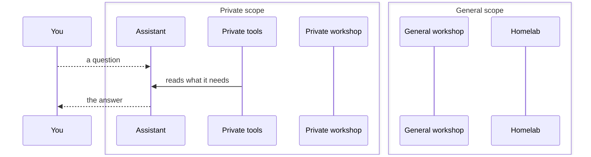
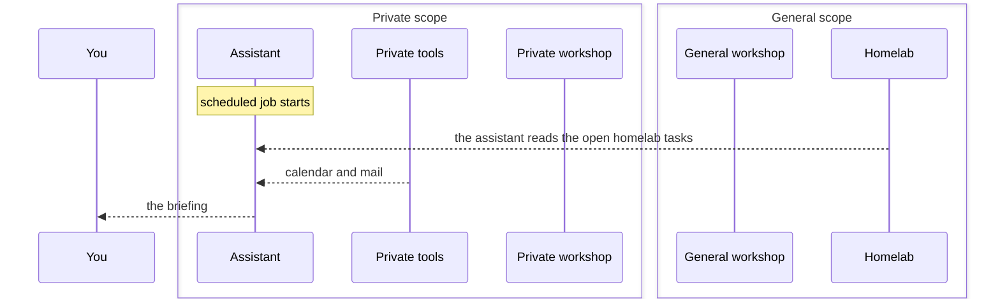
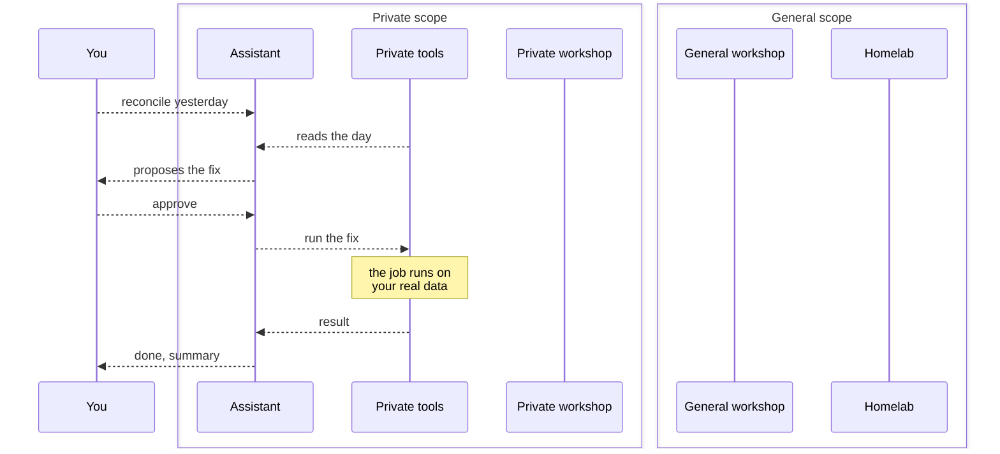
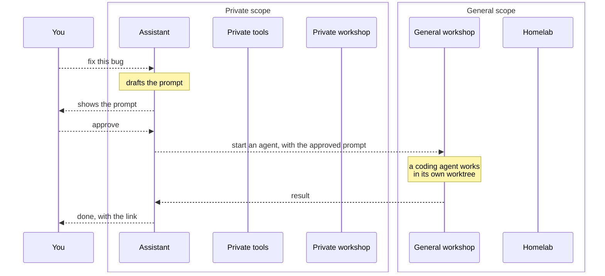
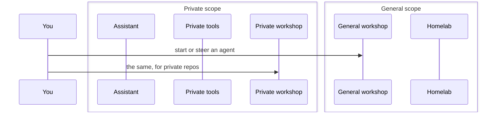
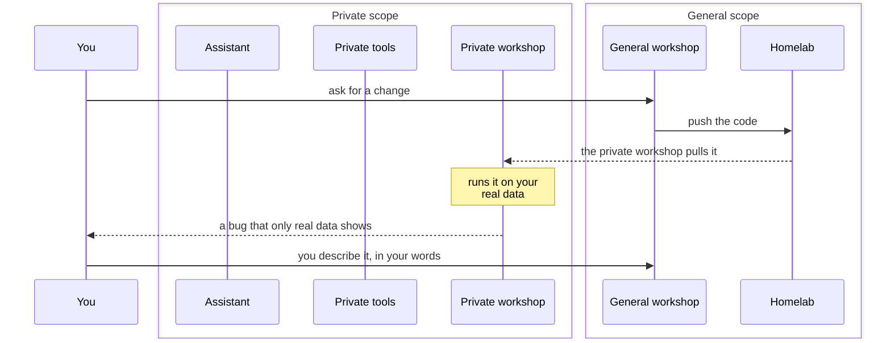
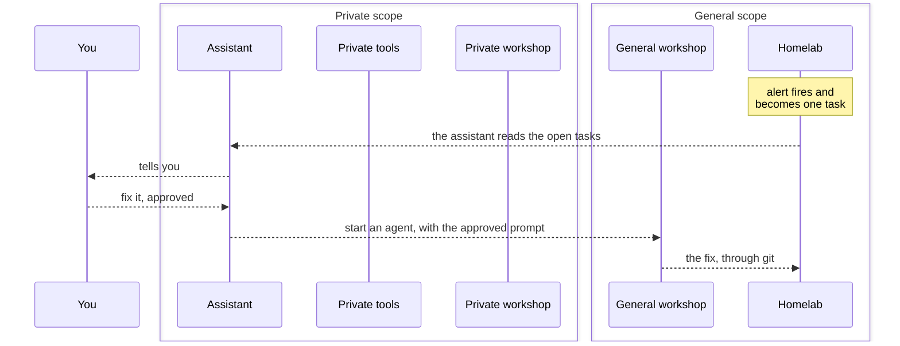

# Flows

How work moves, by design ([DESIGN.md](../DESIGN.md)). How each agent is
connected today is in [wiring.md](./wiring.md).

Every flow uses the same columns, private on the left and general on the right,
so a flow can be judged by what crosses between them.

- A solid arrow works today. A dashed arrow is planned.
- An arrow shows where information moves. The assistant reading something is
  drawn from the thing it reads to the assistant.
- An arrow from the assistant to a tool or a workshop changes something, so it
  waits for your yes.
- An arrow from the private side to the general side carries a prompt you
  approved. Arrows the other way are free.

Each drawing is made by `build.py` from the Mermaid text folded under it. Edit
the text, keep to the arrow and node forms already used, run the script, and
commit both.

## A. Ask the assistant

Status: partly today

You ask the assistant something about your life or your homelab, and it answers from what it can reach.

The same diagram as text

Today the same conversation runs through the private workshop, which opens a chat into the assistant. The messaging app replaces that window.

- Why it is safe: Nothing leaves the private side.
- What it costs: Answers are as good as the trusted models. A private question never falls back to the others.

## B. Morning briefing

Status: planned

A scheduled job gathers your day and sends it to you. Nobody has to ask.

The same diagram as text

In step 2 the assistant is the one acting: it fetches the task list, so the briefing can cover the homelab too. The list moves from general to private, which is the allowed direction.

- Why it is safe: No prompt and no data cross to the general side.
- What it costs: It needs mail and calendar tools that do not exist yet. Whether a trusted model writes a briefing you keep reading takes a week of use to know.

## C. A job on your own data

Status: planned

You ask for work on private data, such as reconciling yesterday's location. The assistant reads what it needs freely, and asks before it changes anything.

The same diagram as text

Each job is a named tool with fixed inputs, so the assistant cannot improvise a command. The private workshop takes no part.

- Why it is safe: Reading stays on the private side. Anything that changes your data is a named tool, and it runs after you say yes.
- What it costs: A job has to be wrapped as a tool before the assistant can run it. Until then you run it yourself in the private workshop, as in flow E.

## D. A coding job for the general workshop

Status: planned

You ask for a code change. The assistant writes the prompt, you read it, and only then does it leave the private side.

The same diagram as text

Step 5 is the only arrow in the whole design that carries something from private to general.

- Why it is safe: The prompt is the one thing that crosses, and you read it first. The result comes back freely.
- What it costs: One extra tap for every coding request made through the assistant. To skip it, start the agent yourself, as in flow E.

## E. You, directly

Status: works today

The workshops do not depend on the assistant. You open the workshop's app and start or steer agents yourself.

The same diagram as text

This is how you work today, and it stays next to flow D.

- Why it is safe: You choose the workshop, so you choose which models see the work.
- What it costs: The private workshop cannot clone repos yet. It needs its own git credential first.

## F. Code in general, data in private

Status: partly today

Repos hold code and services hold data. A general agent writes the code without the data, and the private side runs it on the real thing.

The same diagram as text

Code moves from general to private. What you say in step 6 is your call.

- Why it is safe: The general side gets the code and never the data.
- What it costs: When a bug depends on your data, the general agent works blind and you carry the details across by hand.

## G. A homelab alert

Status: planned

Monitoring stays the detector. An alert becomes one task, the assistant tells you, and the fix is a coding job like any other.

The same diagram as text

Steps 4 and 5 are flow D, shortened.

- Why it is safe: Alerts and tasks are general data, so the assistant may read them. The fix crosses behind the same approval.
- What it costs: The assistant sees only what monitoring already detects. Urgent alerts keep reaching you the way they do today.
