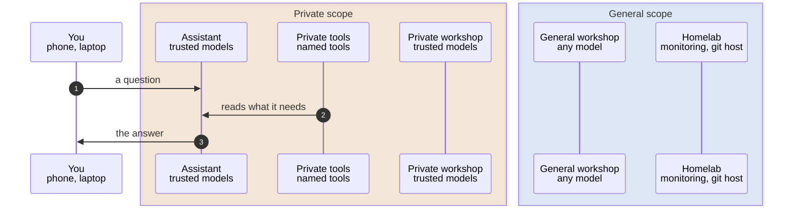
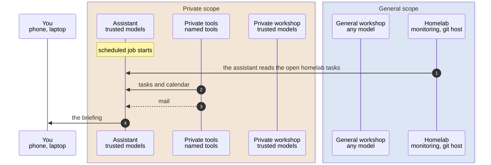
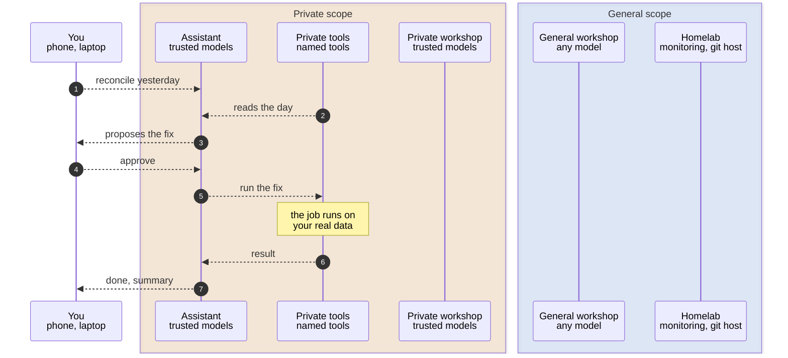
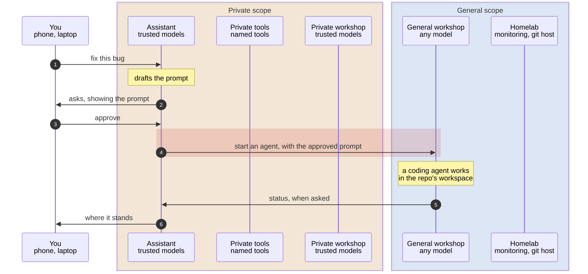
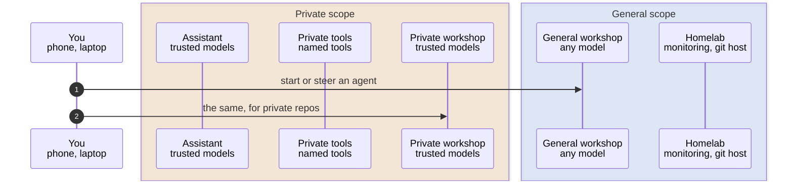
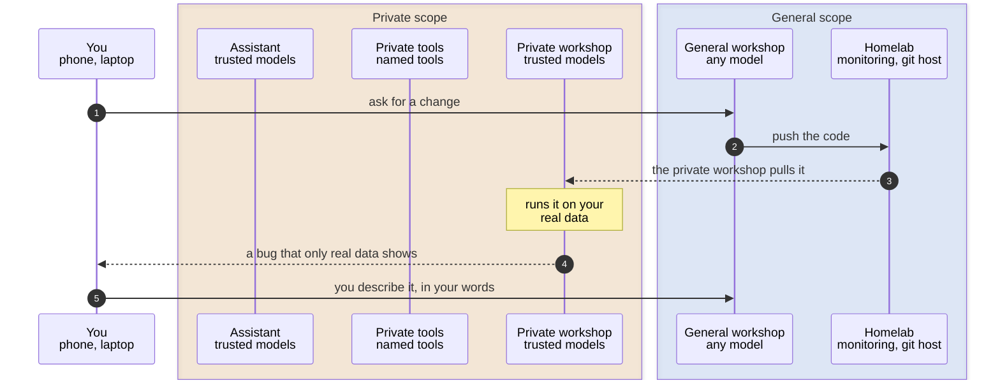
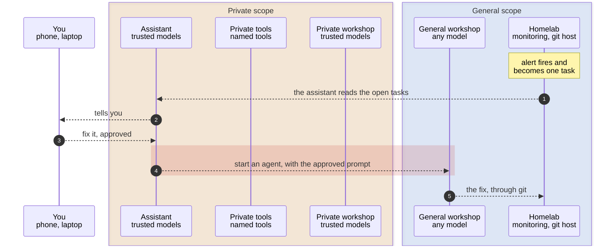
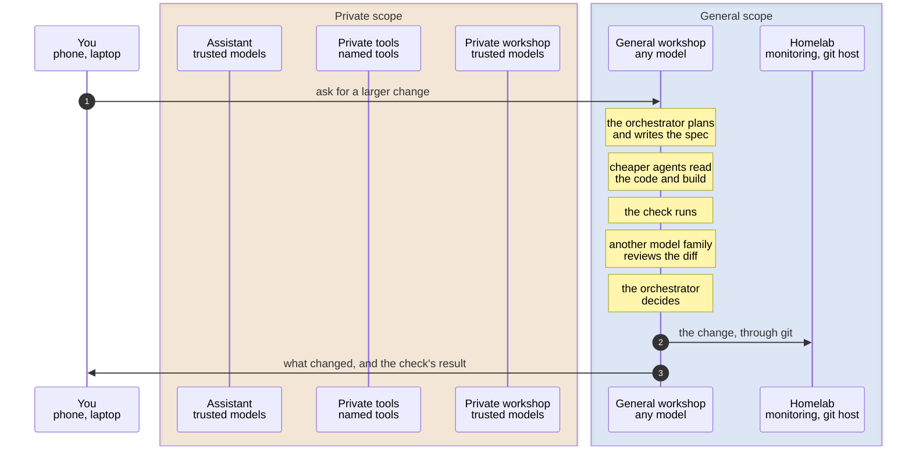

# Flows

How work moves, as decided in the handbook's
[Decisions](https://github.com/h-wb/handbook/tree/main/Decisions). How each agent is
connected today is in [wiring.md](./wiring.md).

Every flow uses the same columns, private on the left and general on the right,
so a flow can be judged by what crosses between them.

- A solid arrow works today. A dashed arrow is planned.
- An arrow shows where information moves. The assistant reading something is
  drawn from the thing it reads to the assistant.
- An arrow from the assistant to a tool or a workshop changes something, so it
  waits for your yes.
- An arrow from the private side to the general side carries a prompt you
  approved, and is shaded red. Arrows the other way are free.
- Arrows are numbered in order; notes are not.

## A. Ask the assistant

Status: works today

You ask the assistant something about your life or your homelab, and it answers from what it can reach.

You write in the messaging app, Matrix, from Beeper or any Matrix app signed in to our server. The dashboard on the LAN and tailnet, and the iOS apps that use it, are another way in. The private workshop can still open a chat into the assistant through the exec bridge.

- Why it is safe: Nothing crosses to the general side, and the assistant answers only the accounts on its allow list.
- What it costs: Answers are as good as the trusted models. A private question never falls back to the others. What you and the assistant write passes through the messaging service: our own Matrix homeserver, end-to-end encrypted.

## B. Morning briefing

Status: partly today

A scheduled job gathers your day and sends it to you. Nobody has to ask.

In step 1 the assistant is the one acting: it fetches the homelab task list, so the briefing can cover the homelab too. The list moves from general to private, which is the allowed direction. Tasks and calendar events come from the task service today; mail is planned.

- Why it is safe: No prompt and no data cross to the general side.
- What it costs: Mail needs a tool the catalogue does not have yet, and the calendar is only what the task service shows.

## C. A job on your own data

Status: planned

You ask for work on private data, such as reconciling yesterday's location. The assistant reads what it needs freely, and asks before it changes anything.

Each job is a named tool with fixed inputs, so the assistant cannot improvise a command. The private workshop takes no part.

- Why it is safe: Reading stays on the private side. Anything that changes your data is a named tool, and it runs after you say yes.
- What it costs: A job has to be wrapped as a tool before the assistant can run it. Until then you run it yourself in the private workshop, as in flow E.

## D. A coding job for the general workshop

Status: works today

You ask for a code change. The assistant writes the prompt, you read it on the approval card, and only then does it leave the private side.

Step 4 is the only arrow in the whole design that carries something from private to general.

- Why it is safe: The prompt is the one thing that crosses, and you read it first. The result comes back freely.
- What it costs: One tap for every prompt sent through the assistant, with no way to approve for good. The card shows the first 1200 characters; a longer prompt is cut off on your screen. To skip all this, start the agent yourself, as in flow E.

The same hand-off works into the private workshop, for work that needs your data. Nothing crosses a boundary there, but it starts an agent with a shell, so it asks every time too.

## E. You, directly

Status: works today

The workshops do not depend on the assistant. You open the workshop's app and start or steer agents yourself.

This is how you work today, and it stays next to flow D.

- Why it is safe: You choose the workshop, so you choose which models see the work.
- What it costs: The private workshop cannot clone repos yet. It needs its own git credential first.

## F. Code in general, data in private

Status: partly today

Repos hold code and services hold data. A general agent writes the code without the data, and the private side runs it on the real thing.

Code moves from general to private. What you say in step 5 is your call.

- Why it is safe: The general side gets the code and never the data.
- What it costs: When a bug depends on your data, the general agent works blind and you carry the details across by hand.

## G. A homelab alert

Status: planned

Monitoring stays the detector. An alert becomes one task, the assistant tells you, and the fix is a coding job like any other.

Steps 3 and 4 are flow D, shortened. The `alert-triage` routine exists but has no schedule, so it does not run.

- Why it is safe: Alerts and tasks are general data, so the assistant may read them. The fix crosses behind the same approval.
- What it costs: The assistant sees only what monitoring already detects. Urgent alerts keep reaching you the way they do today.

## H. A larger change, orchestrated

Status: works today

A change too large for one agent to do well. The strongest model plans it and decides; cheaper agents do the reading, the building and the review.

Everything between the request and the change stays inside the general workshop. The orchestrator starts each worker from a profile, and each one shows in the workshop's app as its sub-agent, where you can watch and steer it. Through the assistant, step 1 is flow D instead: the same approval, and the agent it starts is the orchestrator.

- Why it is safe: Nothing new crosses the scope line. Every agent in the flow is a general agent, on the general workshop's key, tools and memory.
- What it costs: More tokens in total than one agent would use; the saving is that most of them are cheap ones. A worker starts cold, so a small change is slower this way and the orchestrator does those itself. The private workshop has no such flow: no agent there starts another, so you pick the profiles yourself.
