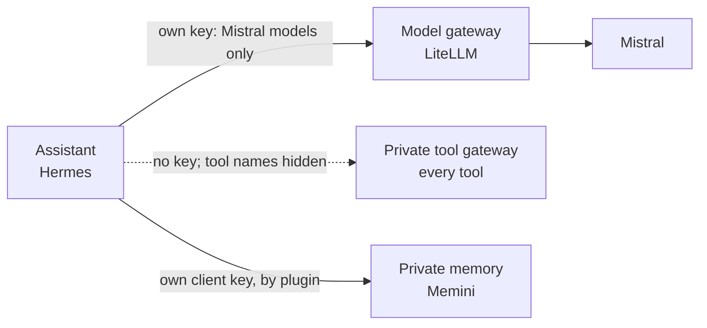
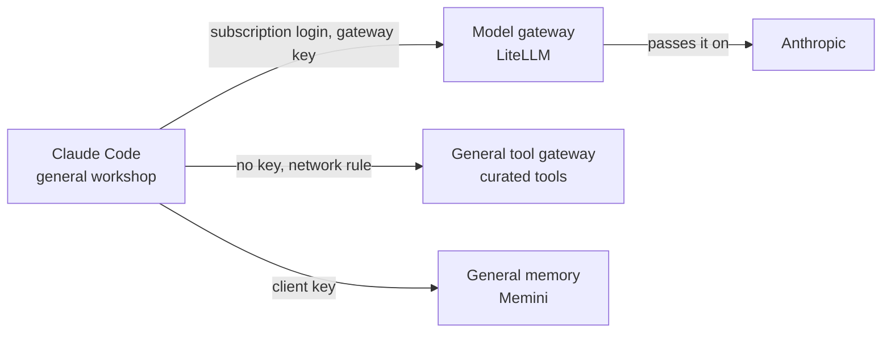
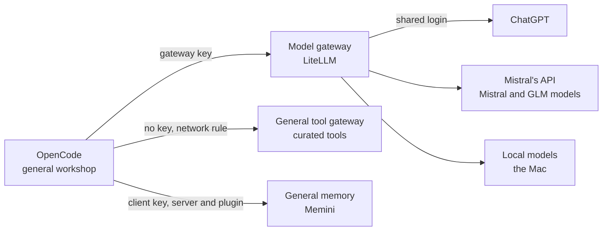
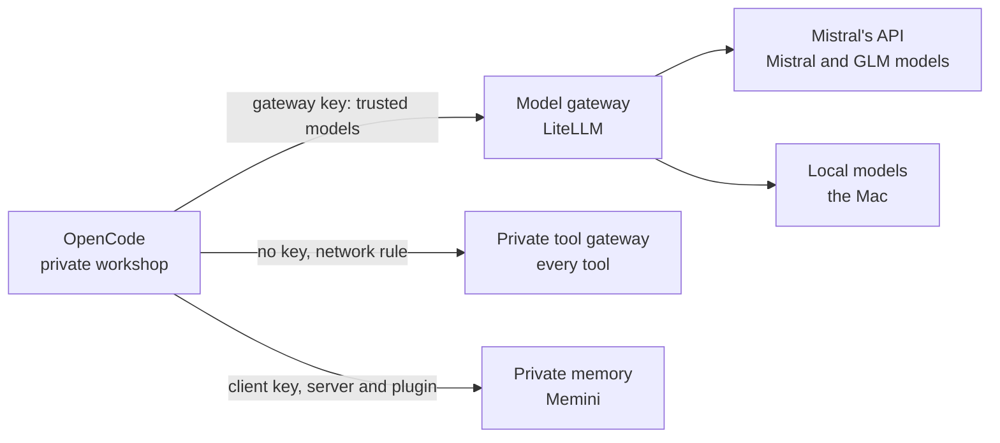
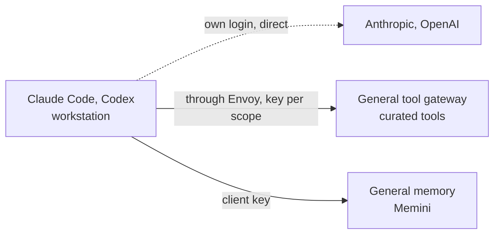
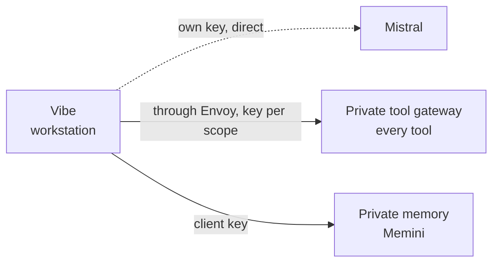

# Wiring

How each agent is connected today: which path its model calls take, where its
tools come from, and where it remembers things. The design it should match is
[DESIGN.md](../DESIGN.md); the flows are in [flows.md](./flows.md).

Read a diagram left to right. A solid arrow is as designed. A dotted arrow
differs from the design, and is explained under
[Differs from the design](#differs-from-the-design).

The published page draws these diagrams with `build.py`; keep to the node and
arrow forms used here so it can read them.

## At a glance

| Agent                       | Runs in          | Scope   | Models                                               | Tools                         | Memory                         |
| --------------------------- | ---------------- | ------- | ---------------------------------------------------- | ----------------------------- | ------------------------------ |
| Assistant (Hermes)          | Its own pod      | Private | Model gateway, own key                               | Private gateway, in-cluster   | Private store, by plugin       |
| Claude Code                 | General workshop | General | Model gateway, which forwards its subscription login | General gateway, in-cluster   | General store                  |
| OpenCode                    | General workshop | General | Model gateway                                        | General gateway, in-cluster   | General store, server + plugin |
| OpenCode                    | Private workshop | Private | Model gateway                                        | Private gateway, in-cluster   | Private store, server + plugin |
| Claude Code, Claude Desktop | Workstation      | General | Anthropic directly, own login                        | General gateway, from outside | General store, from outside    |
| Codex                       | Workstation      | General | OpenAI directly, own login                           | General gateway, from outside | General store, from outside    |
| Vibe                        | Workstation      | Private | Mistral directly, own key                            | Private gateway, from outside | Private store, from outside    |

In the pods the tool gateways need no key: a network rule admits only that
scope's pods, and the tool servers behind them answer the gateways only. From a workstation they are reached through Envoy with a key per
scope. Memory always needs the client's own key. The agents' tool and memory
servers are defined once, in dotfiles (`conf.d/ai/`), and rendered per scope.

## The assistant

Hermes, in its own pod, private scope. Its network rule allows the three
destinations below and DNS, nothing else. The private workshop reaches it
through an exec bridge, which goes once the messaging app is in use.

- Key: `hermes-private`, three Mistral models.
- The memory plugin is a patched build that records nothing unless told to.

## Claude Code in the general workshop

- The gateway holds no Anthropic key: a request without the subscription login
  fails instead of being billed.
- The pod has no Kubernetes credentials; cluster work goes through the tools.

## OpenCode in the general workshop

- Roles today: coordinator on ChatGPT; build, plan and explorer on Mistral
  models; the reviewer on a GLM model.
- The pod also holds a key for OpenCode's own hosted models. None is in use.

## OpenCode in the private workshop

- The gateway is the only provider its config allows. OpenCode's own free
  hosted models, which need no key, are switched off here.

## Claude Code, Claude Desktop and Codex on a workstation

General scope. Keys come from Proton Pass through fnox when the agent starts.

## Vibe on a workstation

Private scope.

## Services that call models

Not agents, but they hold a model gateway key too.

| Service                       | Models on its key                      |
| ----------------------------- | -------------------------------------- |
| Both memory stores            | In-cluster embeddings                  |
| Both tool gateways            | In-cluster embeddings, for tool search |
| Paperless and its OCR helper  | Local models, in-cluster embeddings    |
| Karakeep                      | ChatGPT, in-cluster embeddings         |
| Kritika (pull request review) | ChatGPT, in-cluster embeddings         |
| Lingarr                       | ChatGPT                                |

## Differs from the design

1. **The assistant cannot see tool names.** The tool gateways put every tool
   behind `find_tool` and `call_tool`. "Writes ask" needs the real names.
   Decided: give the assistant the tools without the search step.
2. **OpenCode records conversations by itself.** Its memory plugin recalls
   before every turn and records after it, in both workshops; the memory
   server next to it adds the on-demand tools. The assistant's plugin is
   patched to record only when told. Each writes to its own scope's store, so
   the rule holds. Leaning: on the private side recording by itself is fine,
   which would also make the assistant's patch unnecessary.
3. **Private agents cannot read general memory yet.** The design lets them
   read it and never write it. Memini has read-only keys for exactly this; none
   is set up.
4. **The private workshop has open internet.** With a shell and private data,
   a tricked agent could send data out. To decide: keep it, or an allowlist.
5. **Workstation agents call their vendors directly.** The gateway is
   in-cluster only. Accepted: tool use is meant to happen in the workshops.
6. **The general workshop holds a key for OpenCode's hosted models.** A second
   path next to the gateway. Accepted for the general workshop only.

Closed on 2026-11-09:

- Tool servers answered any pod in the cluster directly, and private memory was
  guarded by its key alone. Both now have a network rule.
- OpenCode called Mistral's API directly with a key held in the pods, around
  the gateway and its model lists. It now uses the gateway only.
- The private workshop's OpenCode offered its vendor's free hosted models,
  which need no key. Its config now allows the gateway and nothing else.
- The location repo's clone in the general workshop held a data file and a
  notes file. Both moved to the private workshop.
