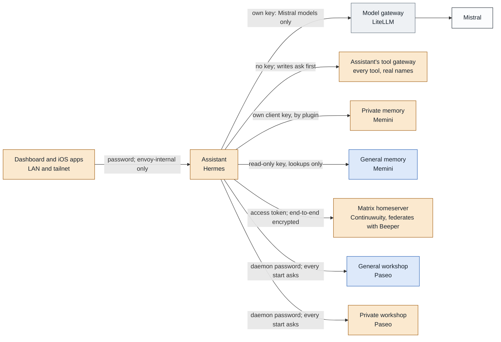
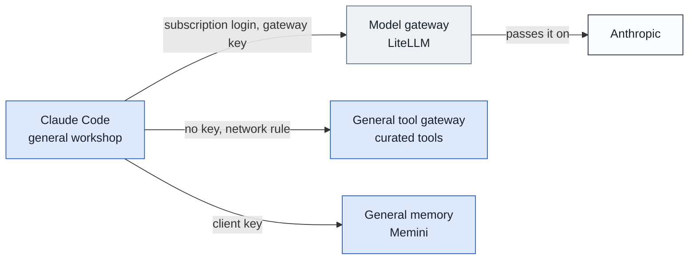
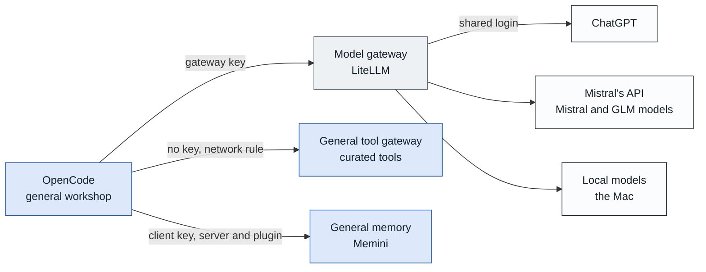
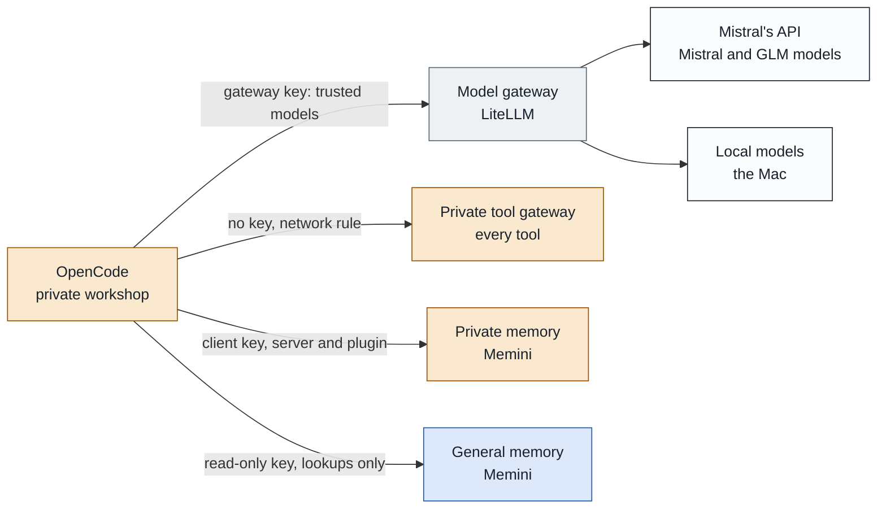
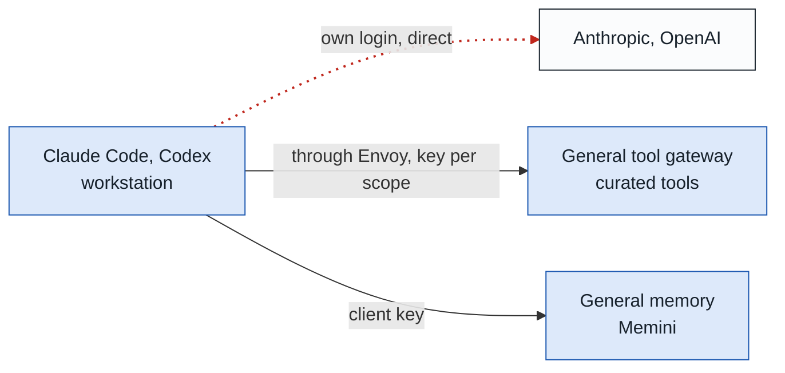
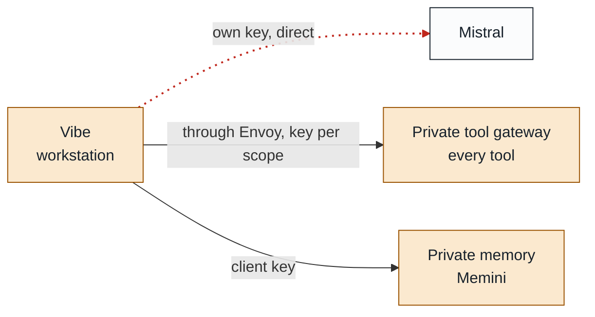

# Wiring

How each agent is connected today: which path its model calls take, where its
tools come from, and where it remembers things. The design it should match is in the
handbook's [Decisions](https://github.com/h-wb/handbook/tree/main/Decisions); the flows are in
[flows.md](./flows.md).

Read a diagram left to right. Orange boxes are private, blue general, grey shared, white
outside. A solid arrow is as designed. A dotted red arrow differs from the design, and is
explained under [Differs from the design](#differs-from-the-design).

## At a glance

| Agent                       | Runs in          | Scope   | Models                                               | Tools                         | Memory                                             |
| --------------------------- | ---------------- | ------- | ---------------------------------------------------- | ----------------------------- | -------------------------------------------------- |
| Assistant (Hermes)          | Its own pod      | Private | Model gateway, own key                               | Its own gateway, in-cluster   | Private store; general, read-only                  |
| Claude Code                 | General workshop | General | Model gateway, which forwards its subscription login | General gateway, in-cluster   | General store                                      |
| OpenCode                    | General workshop | General | Model gateway                                        | General gateway, in-cluster   | General store, server + plugin                     |
| OpenCode                    | Private workshop | Private | Model gateway                                        | Private gateway, in-cluster   | Private store, server + plugin; general, read-only |
| Claude Code, Claude Desktop | Workstation      | General | Anthropic directly, own login                        | General gateway, from outside | General store, from outside                        |
| Codex                       | Workstation      | General | OpenAI directly, own login                           | General gateway, from outside | General store, from outside                        |
| Vibe                        | Workstation      | Private | Mistral directly, own key                            | Private gateway, from outside | Private store, from outside                        |

In the pods the tool gateways need no key: a network rule admits only that
scope's pods, and the tool servers behind them answer the gateways only. From a workstation they are reached through Envoy with a key per
scope. Memory always needs the client's own key. The agents' tool and memory
servers are defined once, in dotfiles (`conf.d/ai/`), and rendered per scope.

## The assistant

Hermes, in its own pod, private scope. Its network rules allow the
destinations below and DNS, nothing else. You reach it in the messaging app,
or through its dashboard on the internal gateway. The private workshop can
also open a chat into it through an exec bridge (`hermes/app/rbac.yaml`, the
`hermes-private` provider in `paseo/private/config/paseo.json`), still deployed.

- Workshops: it can look at either daemon's profiles, workspaces and agents
  freely, and start an agent or send one a prompt after you approve that one
  call. The approval card shows the prompt's first 1200 characters; a longer
  prompt is cut off on your screen, not in what is sent. Seven tools per daemon
  are registered and nothing else: no terminal, no browser, no schedules. The
  daemon password itself would open the rest.
- Matrix: the only messaging app. The bot is on our own homeserver
  (`default/continuwuity`), reached in-cluster; the homeserver, not the pod,
  federates with Beeper. It requires end-to-end encryption and answers the
  Matrix IDs on its allow list; approvals are answered with a reaction (not checked). Routines deliver to
  the Inbox room. Telegram is switched off, and the pod's network rules allow
  no destination on the internet.
- Dashboard: `hermes.${SECRET_DOMAIN}` on `envoy-internal`, password sign-in; the only
  inbound connection the pod's rules allow. The iOS apps use the same address.
- Key: `hermes-private`, five models served by Mistral's API: Mistral Medium
  (the default), Small, Large 4, GLM 5.3, and Voxtral for voice notes. You switch
  per chat. Small does the background jobs; it is too weak to work the tools from a
  plain request.
- Its gateway serves the private catalogue without the search step: Hermes
  searches tools itself, and a call to any tool not marked read-only waits for
  your yes.
- Some servers mark no tool read-only (arr, kubesearch and overseerr when last counted, not
  checked again), so even their lookups ask until you approve a tool for good. Tools approved
  for good are `command_allowlist` in `hermes/app/config.yaml`.
- Its memory plugin recalls before a turn and records after it, like the
  workshops' one. General memory it can only read.
- Routines: skills in `hermes/app/routines/`, mounted read-only. One whose
  front matter has a schedule gets a job when the pod starts, on Toronto time,
  delivered to the Inbox room on Matrix: the briefing at 07:00, a location review
  at 08:30, a nudge at 12:30, a check-in at 20:30, reminders every half hour from
  08:00 to 21:30, and a weekly review on Sunday at 18:00. What each does is in its
  `SKILL.md`. A routine's message joins the chat, so you can answer it; the
  `task-followup` skill then acts on the tasks.
- A scheduled run has nobody to ask, so a call that needs a yes is refused.
  The TickTick task writes and the location review's day pass are approved for
  good, so a scheduled run can make them; the other routines are written to read
  only, which is an instruction and not a lock.
- Documentation: the shared `handbook` skill says how to find the one page
  that answers, and it reads pages from git through the GitHub tool. It holds
  no copy.
- Shared skills: the names it declares (`SKILLS` in
  `hermes/app/skills-sync/job.yaml`: `handbook`, `board`, `tool-gateway`) are
  copied from `h-wb/skills` at a pinned commit by a Job into a volume mounted
  read-only at `/opt/shared-skills`, listed in `skills.external_dirs` next to
  the routines. The pod itself cannot reach GitHub
  ([hermes](../hermes/README.md#skills)).
- Skills and sub-agents are on. Hermes's bundled skills are kept out, except
  the one about itself, which it always adds back. A skill it writes itself
  waits for your yes. Sub-agents get the assistant's tools and no others. It
  cannot schedule jobs by itself.

## Claude Code in the general workshop

- The gateway holds no Anthropic key: a request without the subscription login
  fails instead of being billed.
- The pod has no Kubernetes credentials; cluster work goes through the tools.

## OpenCode in the general workshop

- Roles today: coordinator on ChatGPT; build, plan and explorer on Mistral
  models; the reviewer on a GLM model.
- The pod also holds a key for OpenCode's own hosted models. No profile or mode uses them.

## OpenCode in the private workshop

- The gateway is the only provider its config allows. OpenCode's own free
  hosted models, which need no key, are switched off here.
- General memory is a second server it can only look things up in: its key is
  read-only on the store, which refuses every write.

## Claude Code, Claude Desktop and Codex on a workstation

General scope. Keys come from Proton Pass through fnox when the agent starts. The workstation
side is defined in dotfiles and not checked from here.

## Vibe on a workstation

Private scope.

## Services that call models

Not agents, but they hold a model gateway key too.

| Service                       | Models on its key                      |
| ----------------------------- | -------------------------------------- |
| Both memory stores            | In-cluster embeddings                  |
| Both tool gateways            | In-cluster embeddings, for tool search |
| Paperless                     | Local models, in-cluster embeddings    |
| Paperless GPT (OCR helper)    | Local models                           |
| Karakeep                      | ChatGPT, in-cluster embeddings         |
| Kritika (pull request review) | ChatGPT, Mistral Large 4, embeddings   |
| Lingarr                       | ChatGPT                                |

## Differs from the design

1. **The private workshop has open internet.** With a shell and private data,
   a tricked agent could send data out. Kept as it is for now; whether it gets
   an allowlist is HOMEL-61 on the board.
2. **The general gateway reports itself Degraded** (22 of 23 backends on
   2026-11-24). It health-checks every server in the shared catalogue, the Home
   Assistant one included, which it is rightly not allowed to reach. ToolHive has
   no setting to skip one. Harmless.
3. **Workstation agents call their vendors directly.** The gateway is
   in-cluster only. Accepted: tool use is meant to happen in the workshops.
4. **The general workshop holds a key for OpenCode's hosted models.** A second
   path next to the gateway. Accepted for the general workshop only.

Closed on 2026-11-09:

- Tool servers answered any pod in the cluster directly, and private memory was
  guarded by its key alone. Both now have a network rule.
- OpenCode called Mistral's API directly with a key held in the pods, around
  the gateway and its model lists. It now uses the gateway only.
- The private workshop's OpenCode offered its vendor's free hosted models,
  which need no key. Its config now allows the gateway and nothing else.
- The location repo's clone in the general workshop held a data file and a
  notes file. Both moved to the private workshop.
- The assistant could not see tool names behind the gateway's search step. It
  now has its own gateway with the real names, and asks before a write.
- Private agents could not read general memory. The assistant and the private
  workshop now each have a read-only key and the lookup tools.
