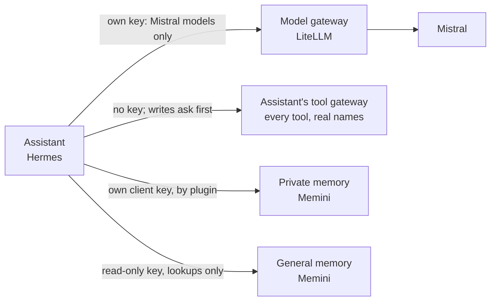
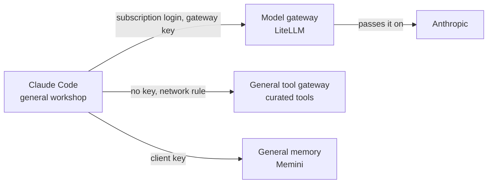
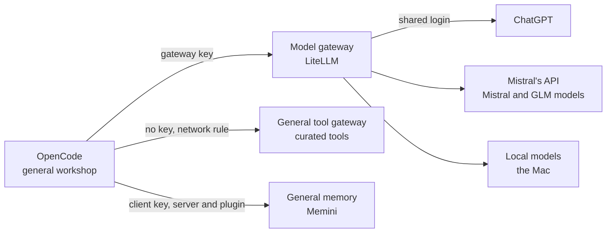
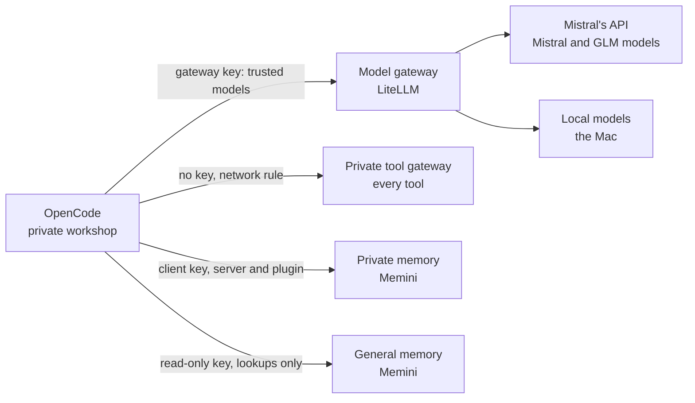
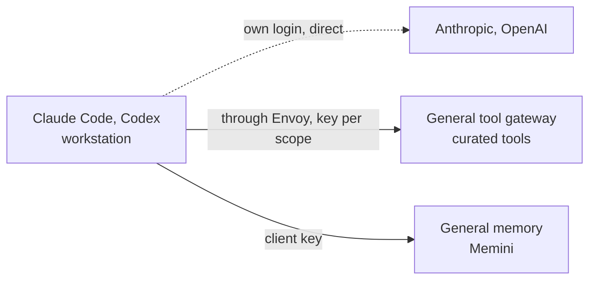
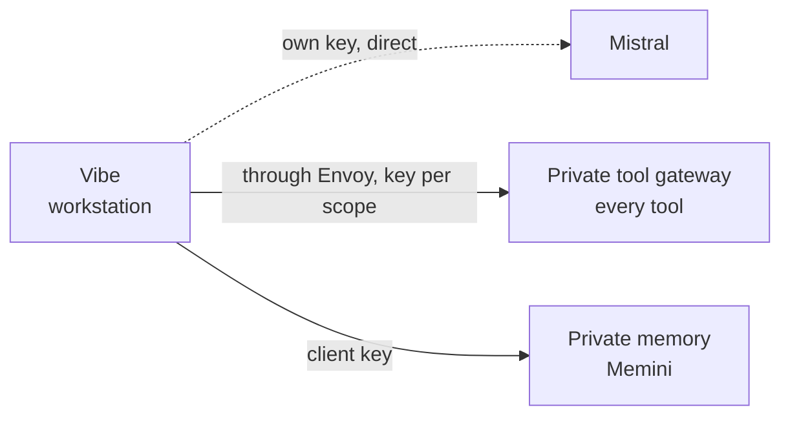

# Wiring

How each agent is connected today: which path its model calls take, where its
tools come from, and where it remembers things. The design it should match is
[DESIGN.md](../DESIGN.md); the flows are in [flows.md](./flows.md).

Read a diagram left to right. A solid arrow is as designed. A dotted arrow
differs from the design, and is explained under
[Differs from the design](#differs-from-the-design).

Each drawing is made by `build.py` from the Mermaid text folded under it. Edit
the text, keep to the arrow and node forms already used, run the script, and
commit both.

## At a glance

| Agent                       | Runs in          | Scope   | Models                                               | Tools                         | Memory                                             |
| --------------------------- | ---------------- | ------- | ---------------------------------------------------- | ----------------------------- | -------------------------------------------------- |
| Assistant (Hermes)          | Its own pod      | Private | Model gateway, own key                               | Its own gateway, in-cluster   | Private store; general, read-only                  |
| Claude Code                 | General workshop | General | Model gateway, which forwards its subscription login | General gateway, in-cluster   | General store                                      |
| OpenCode                    | General workshop | General | Model gateway                                        | General gateway, in-cluster   | General store, server + plugin                     |
| OpenCode                    | Private workshop | Private | Model gateway                                        | Private gateway, in-cluster   | Private store, server + plugin; general, read-only |
| Claude Code, Claude Desktop | Workstation      | General | Anthropic directly, own login                        | General gateway, from outside | General store, from outside                        |
| Codex                       | Workstation      | General | OpenAI directly, own login                           | General gateway, from outside | General store, from outside                        |
| Vibe                        | Workstation      | Private | Mistral directly, own key                            | Private gateway, from outside | Private store, from outside                        |

In the pods the tool gateways need no key: a network rule admits only that
scope's pods, and the tool servers behind them answer the gateways only. From a workstation they are reached through Envoy with a key per
scope. Memory always needs the client's own key. The agents' tool and memory
servers are defined once, in dotfiles (`conf.d/ai/`), and rendered per scope.

## The assistant

Hermes, in its own pod, private scope. Its network rule allows the
destinations below and DNS, nothing else. The private workshop reaches it
through an exec bridge, which goes once the messaging app is in use.

The same diagram as text

- Key: `hermes-private`, three Mistral models.
- Its gateway serves the private catalogue without the search step: Hermes
  searches tools itself, and a call to any tool not marked read-only waits for
  your yes.
- Of the 690 tools, 401 are marked read-only by their servers. Three servers
  mark none (arr, kubesearch, overseerr), so even their lookups ask until you
  approve a tool for good.
- Its memory plugin recalls before a turn and records after it, like the
  workshops' one. General memory it can only read.

## Claude Code in the general workshop

The same diagram as text

- The gateway holds no Anthropic key: a request without the subscription login
  fails instead of being billed.
- The pod has no Kubernetes credentials; cluster work goes through the tools.

## OpenCode in the general workshop

The same diagram as text

- Roles today: coordinator on ChatGPT; build, plan and explorer on Mistral
  models; the reviewer on a GLM model.
- The pod also holds a key for OpenCode's own hosted models. None is in use.

## OpenCode in the private workshop

The same diagram as text

- The gateway is the only provider its config allows. OpenCode's own free
  hosted models, which need no key, are switched off here.
- General memory is a second server it can only look things up in: its key is
  read-only on the store, which refuses every write.

## Claude Code, Claude Desktop and Codex on a workstation

General scope. Keys come from Proton Pass through fnox when the agent starts.

The same diagram as text

## Vibe on a workstation

Private scope.

The same diagram as text

## Services that call models

Not agents, but they hold a model gateway key too.

| Service                       | Models on its key                      |
| ----------------------------- | -------------------------------------- |
| Both memory stores            | In-cluster embeddings                  |
| Both tool gateways            | In-cluster embeddings, for tool search |
| Paperless and its OCR helper  | Local models, in-cluster embeddings    |
| Karakeep                      | ChatGPT, in-cluster embeddings         |
| Kritika (pull request review) | ChatGPT, in-cluster embeddings         |
| Lingarr                       | ChatGPT                                |

## Differs from the design

1. **The private workshop has open internet.** With a shell and private data,
   a tricked agent could send data out. Kept as it is for now; an open
   decision.
2. **The general gateway reports itself unhealthy.** It health-checks every
   server in the shared catalogue, the Home Assistant one included, which it
   is rightly not allowed to reach. ToolHive has no setting to skip one.
   Harmless.
3. **Workstation agents call their vendors directly.** The gateway is
   in-cluster only. Accepted: tool use is meant to happen in the workshops.
4. **The general workshop holds a key for OpenCode's hosted models.** A second
   path next to the gateway. Accepted for the general workshop only.

Closed on 2026-11-09:

- Tool servers answered any pod in the cluster directly, and private memory was
  guarded by its key alone. Both now have a network rule.
- OpenCode called Mistral's API directly with a key held in the pods, around
  the gateway and its model lists. It now uses the gateway only.
- The private workshop's OpenCode offered its vendor's free hosted models,
  which need no key. Its config now allows the gateway and nothing else.
- The location repo's clone in the general workshop held a data file and a
  notes file. Both moved to the private workshop.
- The assistant could not see tool names behind the gateway's search step. It
  now has its own gateway with the real names, and asks before a write.
- Private agents could not read general memory. The assistant and the private
  workshop now each have a read-only key and the lookup tools.
