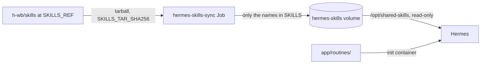

# Hermes: the assistant

The [assistant](https://github.com/h-wb/handbook/blob/main/Systems/Assistant.md), running as
`hermes-private-0` in `llm`. Surrounding services, scopes and routines are in
[Models, tools and memory](../README.md); how it connects, in [wiring](../docs/wiring.md#the-assistant).

| Path                           | What it holds                                       |
| ------------------------------ | --------------------------------------------------- |
| `app/config.yaml`              | Models, tools, approvals, dashboard; read-only      |
| `app/helmrelease.yaml`         | The pod, its messaging settings and the dashboard   |
| `app/externalsecret.yaml`      | Messaging, dashboard and workshop credentials       |
| `app/networkpolicy.yaml`       | What the pod may reach, and who may reach it        |
| `app/SOUL.md`, `app/routines/` | Standing instructions and scheduled routines        |
| `app/skills-sync/`             | The skills it takes from h-wb/skills, and their Job |

## Messaging

- Matrix only. Telegram is disabled in the managed config
  (`platforms.telegram.enabled: false` in `app/config.yaml`). The bot
  `@hermes:matrix.${SECRET_DOMAIN}` on our own homeserver,
  [Continuwuity](../../default/continuwuity/) in `default`, reached in-cluster.
  End-to-end encrypted (`MATRIX_E2EE_MODE=required`), one conversation per
  room. You talk to it from Beeper (a Beeper account is a Matrix account) or
  from any Matrix app signed in to an account on our server.
- Cron and cross-platform messages (routines, alerts) are delivered to the
  encrypted Inbox room in the bot's Space, pinned as `MATRIX_HOME_ROOM` in
  the managed pod env (`app/helmrelease.yaml`). The managed value wins; a
  `!sethome` in chat does not override it. Invite the bot to every room you
  want to talk in, not just the Space.

The homeserver is public on `matrix.${SECRET_DOMAIN}`, which is also its server name,
because Beeper's server reaches it over federation. It federates with
`beeper.com` only, and registration is closed unless a token is set.

### Matrix setup

1. On a fresh database the server prints a one-time registration token in its
   log. In Element web, choose `matrix.${SECRET_DOMAIN}` as the homeserver and register
   `admin` with it; the first account is the server admin and is invited to
   the Admin Room. (Later, `REGISTRATION_TOKEN` in the Bitwarden item
   `continuwuity` opens registration again; keep that item as `{}`.)
2. In the Admin Room: `!admin users create-user hermes`. It replies with a
   password.
3. Sign in to Element web as `hermes`, set up recovery (Settings → Encryption)
   and keep the recovery key.
4. Log in once more for Hermes's own device. Don't reuse Element's token: two
   clients on one device break its encryption.

   ```sh
   read -rs PW; curl -s https://matrix.${SECRET_DOMAIN}/_matrix/client/v3/login \
     -H 'Content-Type: application/json' \
     -d "{\"type\":\"m.login.password\",\"identifier\":{\"type\":\"m.id.user\",\"user\":\"hermes\"},\"password\":\"$PW\",\"initial_device_display_name\":\"Hermes\"}" \
     | jq -r .access_token; unset PW
   ```

   Then sign `hermes` out of Element, so the account has Hermes's device only.

5. Add the Matrix fields below to the Bitwarden item `hermes`.
6. In Beeper Desktop or Android (iOS cannot start Matrix chats), start a chat
   with `@hermes:matrix.${SECRET_DOMAIN}`. Hermes accepts the invite; expect a reply to a
   message. The chat then shows on every Beeper device.

If Beeper cannot reach the bot, check federation at
<https://federationtester.matrix.org> with `matrix.${SECRET_DOMAIN}`.

### Other clients

Any Matrix app works with an account on our server; no federation is involved.
Element X (iOS) needs simplified sliding sync, which the server supports.

1. In the Admin Room: `!admin users create-user <name>`.
2. Add `@<name>:matrix.${SECRET_DOMAIN}` to `MATRIX_ALLOWED_USERS` (comma-separated).
3. Sign in to the app with the server `matrix.${SECRET_DOMAIN}` and start a chat with
   `@hermes:matrix.${SECRET_DOMAIN}`.

Beeper cannot sign in to this server, so that is a second account and a second
conversation; Hermes's memory spans both. An account on another server (e.g.
matrix.org) also needs its server added to `CONTINUWUITY_ALLOWED_REMOTE_SERVER_NAMES`.
A new device reads only messages sent after it joined, unless it is verified with
the recovery key.

### Voice and images

Encrypted attachments are decrypted in the pod. Voice notes are transcribed by
Voxtral through the internal LiteLLM proxy with automatic language detection;
images are analyzed to text by Mistral Large 4 through the same proxy. Answers
are text. The audio/image content is sent to Mistral's API to process it.

The bot's crypto store lives on Hermes's data volume
(`platforms/matrix/store/`). Losing it means a new token (a new device); old
messages stay unreadable to the bot.

Inbox, Chat and Homelab are free-response rooms (`MATRIX_FREE_RESPONSE_ROOMS`):
Hermes answers allowed senders without an @mention, even with both your local
and Beeper accounts joined. Other group rooms still require a mention. New
assistant rooms must be added to that room-ID list explicitly.

## Skills

Hermes reads two folders (`skills.external_dirs` in `app/config.yaml`), both read-only in the pod: its routines, `app/routines/`, laid out by the `routines` init container; and the skills it declares from [h-wb/skills](https://github.com/h-wb/skills), at `/opt/shared-skills`.



- The list is `SKILLS` in `app/skills-sync/job.yaml`: `handbook`, `board`, `tool-gateway`. `handbook` is how it finds documentation: the one page that answers, read from git through the GitHub tool.
- The Job downloads the catalogue at `SKILLS_REF`, checks the tarball against `SKILLS_TAR_SHA256`, and swaps each declared skill into the volume. A name no longer declared leaves the volume; a declared name missing from the catalogue fails the Job before the volume changes. The pod itself cannot reach GitHub.
- To take a skill, add its name to `SKILLS`. To move the pin, set `SKILLS_REF` to a commit of h-wb/skills and `SKILLS_TAR_SHA256` to the output of `curl -fsSL https://codeload.github.com/h-wb/skills/tar.gz/<sha> | sha256sum`. Either change reruns the Job.
- The pin is the head of h-wb/skills#1's branch, not `main` (HOMEL-135).
- A routine is a skill only the assistant runs, kept beside it here; a skill other agents use goes to h-wb/skills.

## Dashboard

`https://hermes.${SECRET_DOMAIN}` on `envoy-internal`: LAN and tailnet only,
username `hermes`. It serves the browser dashboard and the iOS clients (Hermes
Mobile, Hermex), which connect to the same address.

The password is an admin login: the dashboard edits Hermes's own settings and
runs chats with the assistant's tools. The managed config (`/etc/hermes`) still
wins over anything set there.

## Credentials

All in the Bitwarden item `hermes`. The Matrix fields are needed for messaging;
the dashboard fields are optional, and each feature stays off until its fields
exist. The old Telegram fields (`TELEGRAM_BOT_TOKEN`, `TELEGRAM_ALLOWED_USERS`,
`TELEGRAM_HOME_CHANNEL`) may still be in the item (not checked), but nothing reads them:
Telegram is disabled in the managed config and no ExternalSecret maps them.

| Field                      | Value                                                                                  |
| -------------------------- | -------------------------------------------------------------------------------------- |
| `MATRIX_ACCESS_TOKEN`      | From step 4; withheld until `MATRIX_ALLOWED_USERS` is set                              |
| `MATRIX_ALLOWED_USERS`     | Full Matrix IDs it answers (commas): `@you:beeper.com`, `@you:matrix.${SECRET_DOMAIN}` |
| `MATRIX_RECOVERY_KEY`      | From step 3; lets the bot verify its own device                                        |
| `DASHBOARD_PASSWORD`       | Starts the dashboard (optional)                                                        |
| `DASHBOARD_SESSION_SECRET` | Any random string; keeps sign-ins across restarts                                      |
