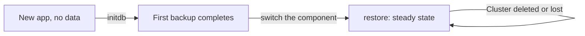

# CloudNativePG Components

Each app that needs PostgreSQL gets its own CloudNativePG `Cluster` named `postgres-${APP}` in its namespace, built from these Components and backed up to the NAS object store through plugin-barman-cloud. The layout follows [vrozaksen/home-ops](https://github.com/vrozaksen/home-ops).

## Components

```
cnpg/
├── base/        Cluster, ObjectStore, ScheduledBackup, ExternalSecret (no bootstrap)
├── initdb/      base + bootstrap an empty database
├── restore/     base + bootstrap from the Barman backup
├── pooler/      opt-in PgBouncer Pooler
└── extensions/
    ├── postgis/ CREATE EXTENSION postgis at initdb
    └── vchord/  VectorChord mounted from an image (PostgreSQL 18)
```

An app references exactly one of `initdb` or `restore`; each pulls in `base`. The bootstrap section only runs when the `Cluster` is created, so changing it on a running database does nothing until the database is recreated.



- New database: deploy with [`initdb`](initdb/README.md), wait for the first backup (`ScheduledBackup` uses `immediate: true`, then `@daily`), then switch to `restore`.
- Existing data in a PostgreSQL outside CNPG: no Component covers it today. The `cnpg/import` Component (`pg_dump | pg_restore` from a live source, with CrunchyData defaults) was removed in 2026-11 and is in git history.
- Steady state: `restore`. A recreated `Cluster` recovers from the latest backup instead of coming back empty. If no backup exists yet, the `Cluster` fails to bootstrap.

Check for a completed backup with `kubectl -n <ns> get backup -l cnpg.io/cluster=postgres-<app>`. To recover to an earlier point in time, see [RECOVERY.md](RECOVERY.md).

## Use it in an app

In the app's `ks.yaml`:

```yaml
spec:
  components:
    - ../../../../../components/cnpg/restore
  dependsOn:
    - name: plugin-barman-cloud
      namespace: database
  healthCheckExprs:
    - apiVersion: postgresql.cnpg.io/v1
      kind: Cluster
      failed: status.conditions.filter(e, e.type == 'Ready').all(e, e.status == 'False')
      current: status.conditions.filter(e, e.type == 'Ready').all(e, e.status == 'True')
  postBuild:
    substitute:
      APP: myapp
```

`plugin-barman-cloud` depends on the CloudNativePG operator, so the one `dependsOn` covers both. Extensions come after the bootstrap Component: `postgis` patches `bootstrap.initdb` and needs the PostGIS image (`CNPG_IMAGE: ghcr.io/cloudnative-pg/postgis`, `CNPG_VERSION: 18-3-system-trixie`, the image dawarich runs; no app uses `postgis` today); `vchord` keeps the standard image and mounts the extension from `ghcr.io/tensorchord/vchord-scratch` (as in `immich`).

Component patches run before Flux substitution, so the `Cluster` is still literally `postgres-${APP}` when they apply. Target it by group and kind.

## Connect

CloudNativePG creates the role and database `${APP}` (override with `CNPG_USER`, `CNPG_DATABASE`) and the Secret `postgres-${APP}-app` with keys `uri`, `jdbc-uri`, `host`, `port`, `dbname`, `username`, `password` and `pgpass`. `host` is `postgres-${APP}-rw`; from another namespace use `postgres-${APP}-rw.<ns>.svc`. Only the `rw` service exists (`CNPG_DISABLED_SERVICES` removes `ro` and `r`).

```yaml
env:
  - name: DATABASE_URL
    valueFrom:
      secretKeyRef:
        name: postgres-${APP}-app
        key: uri
```

Superuser access is enabled; CloudNativePG generates `postgres-${APP}-superuser`.

## Pooler

No app uses it today. Reference `../../../../../components/cnpg/pooler` beside the bootstrap Component to get a PgBouncer `Pooler` at `pooler-${APP}-rw` (port 5432), then point the app's host at it. The generated Secret still points at `postgres-${APP}-rw`. `CNPG_POOLER_MODE` is `session` by default; `transaction` breaks `SET`, `LISTEN/NOTIFY` and other session features, `statement` also breaks transactions.

## Backups

The `ObjectStore` writes base backups and WAL to `s3://postgresql/${APP}` on Garage at `https://s3.${SECRET_DOMAIN}` (WAL zstd, data bzip2), kept for `CNPG_RETENTION_POLICY`. The `ExternalSecret` `${APP}-cnpg-secret` takes `AWS_ACCESS_KEY_ID` and `AWS_SECRET_ACCESS_KEY` from the Bitwarden item `postgresql-bucket`, shared by every app; the bucket is created by the [Garage bootstrap](../../../docker/truenas/README.md).

## Variables

Set in the app's `postBuild.substitute`. Defaults are in the manifests.

| Variable                                                                               | Default                                                   | Notes                                                                                |
| -------------------------------------------------------------------------------------- | --------------------------------------------------------- | ------------------------------------------------------------------------------------ |
| `APP`                                                                                  | required                                                  | Names the Cluster, Secrets and backup path                                           |
| `CNPG_DATABASE`, `CNPG_USER`                                                           | `${APP}`                                                  | Database and owner                                                                   |
| `CNPG_REPLICAS`                                                                        | `3`                                                       | `2` for small apps. `1` needs `CNPG_BACKUP_TARGET: primary` and no synchronous block |
| `CNPG_SIZE`                                                                            | `2Gi`                                                     | PVC per instance. `5Gi` for 0.5 to 2 GB of data, `10Gi` above                        |
| `CNPG_STORAGECLASS`                                                                    | `local-hostpath`                                          |                                                                                      |
| `CNPG_IMAGE`, `CNPG_VERSION`                                                           | `ghcr.io/cloudnative-pg/postgresql`, `18.1-system-trixie` |                                                                                      |
| `CNPG_ANTI_AFFINITY`                                                                   | `required`                                                | One instance per node; `preferred` allows colocation                                 |
| `CNPG_REQUESTS_CPU`, `CNPG_REQUESTS_MEMORY`, `CNPG_LIMITS_MEMORY`                      | `100m`, `256Mi`, `2Gi`                                    |                                                                                      |
| `CNPG_SYNC_METHOD`, `CNPG_SYNC_NUMBER`, `CNPG_SYNC_DURABILITY`                         | `any`, `1`, `preferred`                                   | Quorum sync; stays writable when standbys are down                                   |
| `CNPG_RANDOM_PAGE_COST`, `CNPG_EFFECTIVE_IO_CONCURRENCY`                               | `1.1`, `200`                                              | SSD tuning                                                                           |
| `CNPG_WAL_KEEP_SIZE`, `CNPG_MAX_SLOT_WAL_KEEP`                                         | `1GB`, `2GB`                                              | Replica catch-up                                                                     |
| `CNPG_BACKUP_TARGET`                                                                   | `prefer-standby`                                          |                                                                                      |
| `CNPG_RETENTION_POLICY`                                                                | `30d`                                                     |                                                                                      |
| `CNPG_DISABLED_SERVICES`                                                               | `['ro', 'r']`                                             |                                                                                      |
| `CNPG_POOLER_MODE`, `CNPG_POOLER_INSTANCES`                                            | `session`, `2`                                            | `pooler` only                                                                        |
| `CNPG_POOLER_REQUESTS_CPU`, `CNPG_POOLER_REQUESTS_MEMORY`, `CNPG_POOLER_LIMITS_MEMORY` | `10m`, `32Mi`, `64Mi`                                     | `pooler` only                                                                        |

## When it goes wrong

- An instance stays Pending: with three instances and required anti-affinity, each needs its own node. Free memory on the full node, or set `CNPG_ANTI_AFFINITY: preferred`. `local-hostpath` binds the PVC only once the pod schedules.
- A stale operator-managed pod blocks a PVC: check its events and owner, then `kubectl -n <ns> delete pod <pod>` and let the operator recreate it.
- A wedged first bootstrap: `kubectl -n <ns> delete pvc -l cnpg.io/cluster=postgres-<app>` makes it bootstrap again. This destroys the data; do it only for a disposable bootstrap, or when you mean to recover and a backup is verified.
- After moving an app to another database, check the configuration the app wrote to its own volume. Nextcloud writes `config.php` once at install, so later Helm changes to the database host are ignored; the override is in [its `local.config.php` values](../../apps/main/default/nextcloud/app/helmrelease.yaml).
- Failover: the operator promotes the most advanced standby and moves the `-rw` service to it. See [CloudNativePG failure modes](https://cloudnative-pg.io/documentation/current/failure_modes/).
